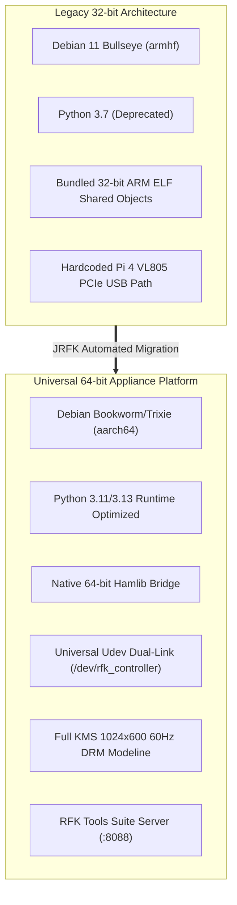

# JRFK — RF-KIT RF2K+ / RF2K-S 32-Bit to 64-Bit Raspberry Pi OS Migration & Tools Suite

### *Turnkey 64-Bit OS Migration for Raspberry Pi 4 & 5, Zero-Loss Calibration Preservation, Automated Weekly Backups & Station Diagnostics*

[-blue.svg)](https://github.com/jbirdlebough1/JRFK)
[](https://github.com/jbirdlebough1/JRFK/releases)
[](LICENSE)
[](https://github.com/jbirdlebough1/JRFK)
[-purple.svg)](docs/JRFK_EM.pdf)

---

> [!CAUTION]
> **RESEARCH EXPERIMENTATION & LIABILITY DISCLAIMER**  
> This software and documentation is purely research experimentation and is provided strictly **"AS IS"**. It communicates directly with high-voltage RF power amplifier hardware and high-current DC power supply subsystems ($53.5\,\text{VDC} @ 55\,\text{A}$). It may damage your amplifier, power supply, LDMOS transistors, exciter/transceiver, antenna system, or computer. The goal of this project is the experimental exploration of what is possible in modern 64-bit embedded Linux platforms, real-time telemetry diagnostics, and resilient disaster recovery for amateur radio linear amplifiers. Users accept all risks and agree to hold authors, contributors, and developers completely harmless regardless of outcome. **USE AT YOUR OWN RISK.**
> 
> **Community Rules:**
> 1. **Open Source & Copyleft:** Keep all innovations accessible, auditable, and free for everyone.
> 2. **Constructive Community:** Keep all commentary positive, helpful, and respectful.
> 3. **Action-Oriented Collaboration:** Write code to solve bugs, fix issues, and share your solutions back with the community.

---

## 🚀 Quick Start: Windows 11 End-to-End Migration & Builder Workbench

The primary workflow is hosted in a self-contained, browser-based workbench located directly in the root of this repository:

👉 **[`JRFK_32_to_64Bit_Migration_tool.htm`](file:///d:/JRFK/JRFK_32_to_64Bit_Migration_tool.htm)** (or launch via **[`JRFK_Migrator.bat`](file:///d:/JRFK/JRFK_Migrator.bat)**)

### Two Build Modes Available:
* **Option A: Migrate Existing 32-Bit RFK SD Image (Primary Option — Data Preserved):**
  1. Insert your original working amplifier SD card into a USB reader $\rightarrow$ click **Extract Golden Master Data** (extracts calibration, touch profiles, attenuator offsets, and network settings into a safe local archive `C:\RFK_Backups\RFK_Golden_Master.tar.gz`).
  2. Remove and safely store your original SD card untouched. Insert a fresh 16GB/32GB A2/V30 SD card $\rightarrow$ click **Build & Flash 64-Bit Appliance Image** (writes 64-bit Bookworm OS, injects weekly Sunday 4:00 AM maintenance cron, injects all user calibrations, and sets `pi:pi 755` permissions).
  3. Insert the new card into your amplifier and follow the automated **Boot 1** (auto-expansion & hardware discovery) $\rightarrow$ **Boot 2** (operational run into full-screen RFKGUI) sequence.
* **Option B: Clean Install — New Card & New System (Provision with Wi-Fi & Credentials):**
  1. Insert a new/blank 16GB or 32GB SD card.
  2. Enter your station credentials: RPi username (default `pi`), password, hostname (default `k7bit`), network mode (DHCP or Static IP), and Wi-Fi SSID / Password.
  3. Click **Partition, Format & Build 64-Bit System** $\rightarrow$ writes 64-bit Bookworm, pre-configures `userconf.txt` and `wpa_supplicant.conf`, enables SSH, and injects the JRFK tools suite.
  4. Boot directly in your amplifier with working Wi-Fi on the network!

### Integrated Capabilities:
* **📖 Full In-Tool Documentation:** Reference the full 56-page [K7BIT Cookbook & Manual](docs/JRFK_EM.html) right inside the migration tool without leaving the browser!
* **🌐 Remote Web Operation Console:** Enter your amplifier's IP address or hostname (e.g. `192.168.1.150` or `k7bit.local`) to test connectivity and remotely launch the **Backup Manager** (`:8088/backup`), **Antenna Mapper** (`:8088/antenna`), and **Health Monitor** (`:8088/health`) directly from Windows 11.

---

## 🎯 Project Overview

**JRFK** is a complete, modernized 64-bit operating system appliance, hardware interface layer, and diagnostic tool suite engineered for the **RF-KIT RF2K-S** and **RF2K+** high-power solid-state amateur radio linear power amplifiers.

Historically, the RF-KIT touch user interface and telemetry logic were tied to legacy 32-bit `armhf` Debian distributions (Debian 10/11) on older Raspberry Pi boards. The introduction of modern 64-bit hardware (Raspberry Pi 4 Model B and Raspberry Pi 5) caused severe driver fragmentation, USB PCIe path collisions, DRM graphics distortions, and ELF binary incompatibility.

JRFK resolves these bottlenecks permanently, delivering:
1. **Universal 64-Bit OS Migration:** Pure Debian 12 Bookworm / Debian 13 Trixie (`aarch64`) runtime with native 64-bit Hamlib bridges and self-healing update shims.
2. **Single-SD Hardware Parity Across Generations:** A single physical MicroSD card boots interchangeably into either a Raspberry Pi 4 or Raspberry Pi 5 without kernel panic, resolution distortion, or serial communication loss.
3. **Decoupled HTTP Diagnostic Suite (Port 8088):** Independent telemetry and monitoring server providing an Antenna SWR Mapper, a 24-Hour Amplifier Health Monitor, and an Automated Backup Manager.
4. **Automated Weekly Cron Backup & Disaster Recovery:** Clones the active boot media to an external USB SD card on an operator-selected weekly schedule, enabling the instant "Swap, Boot, Reboot, Run" disaster recovery workflow with 100% data and calibration retention.



---

## 📚 Master Documentation & Engineering Manuals (`/docs` Folder)

The authoritative 60-page engineering manual, containing 10 standalone vector diagrams, complete register maps, bench calibration steps, and troubleshooting fault trees:

| Document | PDF Edition | Markdown Edition | Description |
| :--- | :--- | :--- | :--- |
| **Master Architecture & Engineering Manual** | [📥 `JRFK_EM.pdf`](docs/JRFK_EM.pdf) *(60 pages)* | [📄 `JRFK_EM.md`](docs/JRFK_EM.md) | Exhaustive 64-bit architecture, controller execution flow, 71 SimpleRPC methods, 17-step K7BIT calibration, 10 unit test plans, and troubleshooting matrix. |

---

## 🛠️ Feature Highlights

### 1. Universal Single-SD Hardware Parity (RPi 4 vs. RPi 5)
* **Udev Dual-Link Engine:** Creates both `/dev/rfk_controller` and legacy `/dev/serial/by-path/platform-fd500000...` symlinks, guaranteeing serial communication regardless of PCIe USB controller topology.
* **Pure Full KMS Display Locking:** Locks `/boot/firmware/cmdline.txt` to `video=HDMI-A-1:1024x600M@60D` ensuring pixel-perfect 60 Hz rendering on the 7-inch touch panel without display borders or touch inversion.
* **Native 64-Bit Hamlib Bridge:** Eliminates the fatal `ELFCLASS32` dynamic linker collision.

### 2. Execution Flow & 71 SimpleRPC Register Catalog
* High-speed $20\,\text{ms}$ to $50\,\text{ms}$ continuous polling loop querying the controller microcontroller (`get_all_values`).
* Complete register-by-register analysis of the 20-element telemetry return tuple (Forward Power, Reflected Power, SWR, 53.5V DC rail, Idq Current, Temperature, Band, Antenna, Tuner steps).
* Fast hardware protection trip monitoring with $< 5\,\text{ms}$ automatic cutoff for over-drive ($> 28\,\text{W}$) and high SWR ($> 3.0:1$).

### 3. Integrated Diagnostic Suite (`rfk_tools_suite` on Port 8088)
* **Antenna Mapper (`/antenna`):** Visual SWR matrix across 160m–6m, band spinner, horizontal scrollbar, click-to-inspect tuner L/C/K steps, and one-click `@media print` network printing.
* **Amplifier Health Monitor (`/health`):** 1-hour high-resolution RAM ring buffer (every 5 seconds) and 24-hour historical SQLite datastore (`telemetry_history.db`) for RF power, 53.5V rail sag, DC current, and temperature with $38^\circ\text{C}$ and $42^\circ\text{C}$ fan trigger overlays.
* **SD Backup & Recovery Manager (`/backup`):** Real-time drive media status, user-configurable weekly cron schedule, and one-click manual backup trigger.

### 4. Automated Weekly Cron Backup & "Swap, Boot, Reboot, Run" Recovery
* **Automated Weekly Schedule:** Set via Web UI (default: Sundays at 03:00 AM, prior to the 04:00 AM OS upgrade).
* **Live Partition Streaming:** Uses `piclone` / block streaming to clone to an external USB SD reader while regenerating unique partition UUIDs (`PARTUUID`).
* **First-Boot Self-Healing Hook (`jrfk_restore_check`):** In an emergency, swap the backup SD card into the internal slot. On power-up, the system self-checks, reboots once, and launches directly into the operational RFKGUI with all user calibrations intact!

---

## 📁 Repository Directory Structure

```text
D:\JRFK
├── JRFK_32_to_64Bit_Migration_tool.htm # Windows 11 Interactive Migration Workbench & Reader
├── JRFK_Migrator.bat                   # One-Click Windows 11 Migration Tool Launcher
├── docs/
│   ├── JRFK_EM.md                       # Master Engineering & Migration Manual (Source)
│   ├── JRFK_EM.html                     # Compiled Standalone HTML Manual with SVG Diagrams
│   ├── JRFK_EM.pdf                      # Master Publication PDF Manual (56 Pages)
│   └── images/diagrams/                 # Native Vector SVG Architectural Diagrams
├── scripts/
│   ├── finalize_sd.sh                   # Chroot staging script for new 64-bit SD cards
│   ├── generate_pdf.py                  # WeasyPrint PDF compilation engine
│   ├── render_diagrams.py               # Mermaid vector SVG rendering pipeline
│   ├── bridge_hamlib.sh                 # 64-bit aarch64 Hamlib compilation script
│   └── patch_antialias.py               # PIL.Image.ANTIALIAS self-healing patcher
└── tools/
    ├── migrator/                        # Windows 11 Migration Tool Backend & Static Server
    │   ├── server.py                    # Local HTTP Server & Drive Detection Daemon (Port 8089)
    │   └── JRFK_32_to_64Bit_Migration_tool.htm
    └── rfk_tools_suite/                 # Diagnostic Suite Server (Port 8088)
        ├── server.py                    # Standalone HTTP Server & Telemetry Polling Daemon
        ├── static/
        │   ├── antenna_mapper.html      # SWR curve, band spinner, IP printing
        │   ├── health_monitor.html      # 1hr & 24hr Canvas Graphs (Power, Sag, Temp)
        │   └── backup_manager.html      # SD media manager & weekly cron scheduler
        └── bin/
            ├── rfk_backup.sh            # Live partition cloner & UUID regenerator
            ├── jrfk_restore_check.sh    # Disaster recovery first-boot verification hook
            ├── jrfk_restore_check.service# Systemd recovery unit
            ├── jrfk_weekly_backup.cron  # Weekly backup cron entry
            ├── jrfk_weekly_upgrade.sh   # Non-interactive OS package upgrade script
            ├── jrfk_weekly_upgrade.cron # Weekly OS upgrade cron entry (Sundays 04:00 AM)
            ├── Antenna_Mapper.desktop   # Desktop shortcut
            ├── Amplifier_Health.desktop # Desktop shortcut
            └── Backup_Manager.desktop   # Desktop shortcut
```

---

## 👥 Author & Community Contributions

* **Author:** John Birdlebough (**K7BIT/AE**, Retired Chief Engineer Tektronix, Wang Labs, Marconi, WaMu, HP Cloud)
* **Contributors:** John Stafford (**Island RF CEO**, RF-KIT US Service Center), Reinhard Förtsch (**DH3NAB**), Mark Mumaw (**NU6X**), and the members of the **RF-KIT B26 Group.IO Community**.

---
*For bug reports, pull requests, or technical discussions, please open an issue on the [JRFK Issue Tracker](https://github.com/jbirdlebough1/JRFK/issues).*
