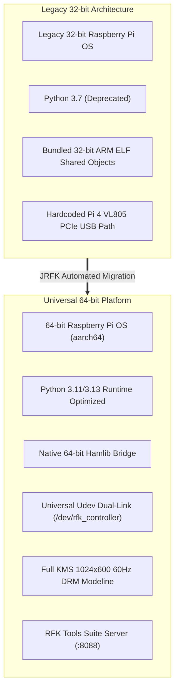

# JRFK — RF-KIT RF2K+ / RF2K-S 32-Bit to 64-Bit Raspberry Pi OS Migration & Tools Suite

### *Turnkey 64-Bit OS Migration for Raspberry Pi 4 & 5, Zero-Loss Calibration Preservation, Automated Weekly Backups & Station Diagnostics*

[-blue.svg)](https://github.com/jbirdlebough1/JRFKTools)
[](https://github.com/jbirdlebough1/JRFKTools/releases)
[](LICENSE)
[](https://github.com/jbirdlebough1/JRFKTools)
[-purple.svg)](docs/JRFK_Cookbook.pdf)

---

## 🎬 Interactive Technical Presentation (Overview & Architecture)

Before downloading or upgrading, you can explore the complete audio-visual technical walkthrough directly in your browser using our auto-advancing blueprint player:

👉 **[Launch Presentation 1: Modernizing the RF-KIT Linear Amplifier (Interactive Web Player)](https://jbirdlebough1.github.io/JRFKTools/deck1/preview.html)**  
*(15-slide technical blueprint walkthrough: covers the 64-bit architecture payoff, PC Migrator Options A & B, two-boot verification, and all on-amplifier Web Tools with synchronized voiceover narration and live telemetry scrolling)*

* 📁 **Source Assets & Transcript**: [Presentations/Deck_1_Intro](https://github.com/jbirdlebough1/JRFKTools/tree/main/Presentations/Deck_1_Intro)
* 📖 **Master Documentation Portal**: [https://jbirdlebough1.github.io/JRFKTools/](https://jbirdlebough1.github.io/JRFKTools/)
* 💻 **Standalone Windows 1-Click Launcher (4 KB)**: [Download Preview_Presentation_1.exe](https://raw.githubusercontent.com/jbirdlebough1/JRFKTools/main/Preview_Presentation_1.exe) *(Zero install, self-contained — click to launch the presentation instantly in your browser)*

---

## ⚡ Fast Download (For Operators — No Developer Tools Required)

If you only want to upgrade or configure your RF-KIT amplifier on Windows 11 without setting up Python, Git, or compilers, download the standalone turnkey migrator:

👉 **[Download Standalone JRFK.exe (Beta 1.0 Release)](https://github.com/jbirdlebough1/JRFKTools/releases/download/v01.00.00-beta/JRFK.exe)**  
*(Self-contained Windows x64 executable: includes embedded UAC elevation, background format prompt suppression, offline 64-bit OS packages, Python 3.13 shims, and the complete 4-manual station documentation library)*

### Quick 3-Step Operator Instructions:
1. **Connect SD Card:** Place your existing 32-bit SD card into a USB reader attached to your Windows PC.
2. **Launch JRFK:** Right-click **`JRFK.exe`** and select **Run as Administrator**. JRFK launches the local web workbench automatically at `http://127.0.0.1:8089/`.
3. **Execute Two-Click Migration:**
   - **Step 1:** Click **Validate & Extract Golden Master Data** (strictly read-only; your original card is 100% safe).
   - **Step 2:** Swap in a fresh blank 32GB MicroSD card and click **Provision SD (Migrate to 64-Bit)**.
4. **Boot in Amplifier:** Insert the new card into your amplifier and power on. The system performs an automated 3-boot sequence directly into full-screen operational production with all calibrations intact!

---

## 🛠️ For Builders & Developers (Tools Folder)

All developer source code, automated build pipelines, unit test suites, and diagnostic daemons are included in the **`tools/`** directory of this repository:
* **`tools/migrator/`**: Core Windows migration engine (`server.py`), drive detection guard, Windows 11 format prompt suppressor, and end-to-end unittest suite (`test_jrfk_e2e.py`).
* **`tools/rfk_tools_suite/`**: Complete 24/7 Raspberry Pi Port 8088 web diagnostic suite:
  - 📖 **Station Docs (`/docs`)**: Central technical reference library with embedded reader and PDF downloaders.
  - 🗺️ **Antenna Mapper (`/antenna`)**: 4-port relay visualizer, dynamic band ribbon, and interactive ATU Bode plot with component inspection.
  - 📈 **Health Monitor (`/health`)**: 5 live gauges, 3 canvas trend charts, and 60°C emergency thermal unkey protection.
  - 📺 **Remote Screen (`/screen`)**: Full KMS 1024x600 real-time mirror (read-only for safe tablet/phone monitoring).
  - 💾 **SD Backup Manager (`/backup`)**: Secondary USB card backup manager and automated Sunday 04:00 GMT cron.
  - 📋 **System Report (`/report`)**: Complete host hardware, storage wear-leveling, and calibration audit.
  - 📜 **Log Viewer (`/logs`)**: Centralized real-time inspector for 4 system log streams.
* **`tools/pi_debs/`**: 15 offline `arm64` Debian packages for turnkey first-boot offline installation.
* **`tools/py_deps/`**: Python 3.13 backward-compatibility shims and Pillow `Image.ANTIALIAS` bindings.
* **`docs/`**: Master station documentation library (HTML & vector PDFs).

---

> [!CAUTION]
> **RESEARCH EXPERIMENTATION & LIABILITY DISCLAIMER**  
> This software and documentation is purely research experimentation and is provided strictly **"AS IS"**. It communicates directly with high-voltage RF power amplifier hardware and high-current DC power supply subsystems (Heiwoo 53.5 VDC @ 55 A). It may damage your amplifier, power supply, LDMOS transistors, exciter/transceiver, antenna system, or computer. The goal of this project is the experimental exploration of what is possible in modern 64-bit embedded Linux platforms, real-time telemetry diagnostics, and resilient disaster recovery for amateur radio linear amplifiers. Users accept all risks and agree to hold authors, contributors, and developers completely harmless regardless of outcome. **USE AT YOUR OWN RISK.**
> 
> **Community Rules:**
> 1. **Open Source & Copyleft:** Keep all innovations accessible, auditable, and free for everyone.
> 2. **Constructive Community:** Keep all commentary positive, helpful, and respectful.
> 3. **Action-Oriented Collaboration:** Write code to solve bugs, fix issues, and share your solutions back with the community.

---

## 📚 Master Documentation Library (`/docs` Folder)

The JRFK station library includes four comprehensive, publication-grade manuals in both interactive HTML and downloadable PDF formats:

| Document | PDF Edition | HTML Edition | Scope & Content |
| :--- | :--- | :--- | :--- |
| **📘 JRFK Operator's Manual & Architecture Guide** | [📥 `JRFK_Users_Guide.pdf`](docs/JRFK_Users_Guide.pdf) | [📄 `JRFK_Users_Guide.html`](docs/JRFK_Users_Guide.html) | Turnkey migration walkthrough, GOLD migration matrix, 7 post-migration web diagnostic tools, 3-boot visual verification, and automated Sunday autopatching. |
| **⚙️ JRFK Engineering Manual** | [📥 `JRFK_EM.pdf`](docs/JRFK_EM.pdf) | [📄 `JRFK_EM.html`](docs/JRFK_EM.html) | Pure-Python SimpleRPC schemas, Python 3.13 deprecation shims, Full KMS DRM 1024x600 modelines, Heiwoo 53.5V PSU architecture, and 60°C thermal guard state machine. |
| **🚨 Disaster Recovery Procedure** | [📥 `JRFK_Disaster_Recovery.pdf`](docs/JRFK_Disaster_Recovery.pdf) | [📄 `JRFK_Disaster_Recovery.html`](docs/JRFK_Disaster_Recovery.html) | Emergency "Swap, Boot, Reboot, Run" card. Rapid recovery walkthrough for primary MicroSD failure using the secondary automated USB backup card (<3 min recovery). |
| **📘 K7BIT B26-RF2K+ Master Cookbook (Rev 1.05)** | [📥 `JRFK_Cookbook.pdf`](docs/JRFK_Cookbook.pdf) *(193 Pages)* | [📄 `JRFK_Cookbook.html`](docs/JRFK_Cookbook.html) | The authentic end-to-end builders, alignment & operators guide by John Birdlebough (K7BIT) and John Stafford (Island RF) with all 158 schematics, diagrams, and photos. |

---

## 🎯 Project Overview & Architectural Model

**JRFK** is a complete, modernized 64-bit operating system appliance, hardware interface layer, and diagnostic tool suite engineered for the **RF-KIT RF2K-S** and **RF2K+** high-power solid-state amateur radio linear power amplifiers.

Historically, the RF-KIT touch user interface and telemetry logic were tied to legacy 32-bit Raspberry Pi OS on older Raspberry Pi boards. The introduction of modern 64-bit hardware (Raspberry Pi 4 Model B and Raspberry Pi 5) caused severe driver fragmentation, USB PCIe path collisions, DRM graphics distortions, and ELF binary incompatibility.

JRFK resolves these bottlenecks permanently, delivering:
1. **Universal 64-Bit OS Migration:** Pure 64-Bit Raspberry Pi OS (`aarch64`) runtime with native 64-bit Hamlib bridges and self-healing update shims.
2. **Single-SD Hardware Parity Across Generations:** A single physical MicroSD card boots interchangeably into either a Raspberry Pi 4 or Raspberry Pi 5 without kernel panic, resolution distortion, or serial communication loss.
3. **Decoupled HTTP Diagnostic Suite (Port 8088):** Independent telemetry and monitoring server providing an Antenna SWR Mapper, a 24-Hour Amplifier Health Monitor with 60°C emergency thermal unkey protection, Remote Screen mirror, and an Automated Backup Manager.
4. **Automated Weekly Cron Backup & Disaster Recovery:** Clones the active boot media to an external USB SD card on an operator-selected weekly schedule, enabling the instant "Swap, Boot, Reboot, Run" disaster recovery workflow with 100% data and calibration retention.



---

## 🛠️ Feature Highlights

### 1. Universal Single-SD Hardware Parity (RPi 4 vs. RPi 5)
* **Udev Dual-Link Engine:** Creates both `/dev/rfk_controller` and legacy `/dev/serial/by-path/platform-fd500000...` symlinks, guaranteeing serial communication regardless of PCIe USB controller topology.
* **Pure Full KMS Display Locking:** Locks `/boot/firmware/cmdline.txt` to `video=HDMI-A-1:1024x600M@60D` ensuring pixel-perfect 60 Hz rendering on the 7-inch touch panel without display borders or touch inversion.
* **Native 64-Bit Hamlib Bridge:** Eliminates the fatal `ELFCLASS32` dynamic linker collision.

### 2. Execution Flow & 71 SimpleRPC Register Catalog
* High-speed 20 ms to 50 ms continuous polling loop querying the controller microcontroller (`get_all_values`).
* Complete register-by-register analysis of the 20-element telemetry return tuple (Forward Power, Reflected Power, SWR, 53.5V DC rail, Idq Current, Temperature, Band, Antenna, Tuner steps).
* Fast hardware protection trip monitoring with < 5 ms automatic cutoff for over-drive (> 28 W) and high SWR (> 3.0:1).

### 3. Integrated Diagnostic Suite (`rfk_tools_suite` on Port 8088)
* **Antenna Mapper (`/antenna`):** Visual SWR matrix across 160m–6m, band ribbon, click-to-inspect tuner L/C steps, and one-click `@media print` network printing.
* **Amplifier Health Monitor (`/health`):** Real-time gauges and 15-minute rolling Canvas Graphs (Power, Sag, Temp) with 60°C emergency thermal unkey protection and 300s cooldown lockout.
* **Remote Screen (`/screen`):** 1024x600 virtual HDMI stream (strictly read-only for safe tablet monitoring).
* **SD Backup & Recovery Manager (`/backup`):** Real-time drive media status, user-configurable weekly cron schedule, and one-click manual backup trigger.
* **System Report (`/report`):** Exhaustive compute, storage wear-leveling, and hardware calibration diagnostics.
* **Log Viewer (`/logs`):** 4 real-time diagnostic streams (`telemetry_rolling.log`, `rfk_backup.log`, `rfk_gui`, `systemd journal`).

---

## 📁 Repository Directory Structure

```text
D:\JRFK
├── JRFK.exe                            # Standalone Windows 11 Executable (Elevated Self-Extracting)
├── JRFK_32_to_64Bit_Migration_tool.htm # Interactive Migration Workbench & Reader
├── JRFK_Migrator.bat                   # One-Click Windows 11 Migration Tool Launcher
├── K7BIT B26 Cookbook Vol 1 R1.5.docx  # Master Source Document for K7BIT Cookbook
├── docs/                               # Master Station Documentation Library
│   ├── JRFK_Users_Guide.html / .pdf    # JRFK Operator's Manual & Architecture Guide
│   ├── JRFK_EM.html / .pdf / .md       # JRFK Engineering Manual (Architecture Deep-Dive)
│   ├── JRFK_Disaster_Recovery.html/.pdf# Emergency "Swap, Boot, Reboot, Run" Procedure
│   ├── JRFK_Cookbook.html / .pdf       # Authentic K7BIT Cookbook (193 Pages, 158 Graphics)
│   └── cookbook_media/                 # All 158 High-Resolution Schematics & Photos
├── scripts/                            # Diagnostic, Build & Verification Scripts
│   └── build_comprehensive_manual.py
└── tools/
    ├── migrator/                       # Windows 11 Migration Engine & Backend Daemon
    │   ├── server.py                   # Local HTTP Server & Drive Detection Daemon (Port 8089)
    │   ├── w11_popup_suppressor.py     # Background Windows 11 Format Prompt Suppressor
    │   ├── sd_guard.py                 # Multi-Layer Drive Safety Lock
    │   ├── build_jrfk_exe.py           # C# Compiler Pipeline for JRFK.exe
    │   └── test_jrfk_e2e.py            # End-to-End Migration Unit Test Suite
    ├── rfk_tools_suite/                # Raspberry Pi Diagnostic Web Suite (Port 8088)
    │   ├── server.py                   # Embedded Async HTTP Server & Telemetry Poller
    │   ├── static/                     # Blueprint UI Screens (Antenna, Health, Docs, Screen, etc.)
    │   └── docs/                       # Internal Appliance Documentation Files
    ├── pi_debs/                        # 15 Offline arm64 Debian Packages for First Boot
    └── py_deps/                        # Offline Python 3.13 Wheels & Compatibility Shims
```

---

## 👥 Authors & Community Contributions

* **Author:** John Birdlebough (**K7BIT/AE**, Retired Chief Engineer Tektronix, Wang Labs, Marconi, WaMu, HP Cloud)
* **Contributors:** John Stafford (**Island RF CEO**, RF-KIT US Service Center), Reinhard Förtsch (**DH3NAB**), Mark Mumaw (**NU6X**), and the members of the **RF-KIT B26 Group.IO Community**.

---
*For bug reports, pull requests, or technical discussions, please open an issue on the [JRFKTools Issue Tracker](https://github.com/jbirdlebough1/JRFKTools/issues).*
