# RFK2K+ / RFK2K-S: 32-Bit to 64-Bit Raspberry Pi OS Migration & Tools Upgrade for RPi 4 or RPi 5 Manual

### *Turnkey Appliance Migration, Zero-Loss Calibration Preservation, Automated Disaster Recovery & Station Diagnostics Suite*

> **Document Identification:** JRFK-EM-2026-V2.0  
> **Classification:** Engineering Specification, Hardware Cookbook & Diagnostic Reference  
> **Target Hardware Platforms:** RF-KIT RF2K-S / RF2K+ (B26-RF01 PA Controller V4 / Arduino Mega 2560 R3 & Updated Proprietary Controller)  
> **Target Compute Engines:** Raspberry Pi 4 Model B (Broadcom BCM2711) & Raspberry Pi 5 (Broadcom BCM2712)  
> **Operating Environment:** Debian 12 Bookworm / Debian 13 Trixie (`aarch64` Pure 64-Bit Appliance)  
> **Author:** John Birdlebough (K7BIT/AE, Retired Chief Engineer Tektronix, Wang Labs, Marconi, WaMu, HP Cloud)  
> **Historical Contributors:** John Stafford (Island RF CEO, RF-KIT US Service Center), Reinhard Förtsch (DH3NAB), Mark Mumaw (NU6X) & The RF-KIT B26 Group.IO Community  

---

> [!CAUTION]
> **RESEARCH EXPERIMENTATION & LIABILITY DISCLAIMER**  
> This software and documentation is purely research experimentation and is provided strictly **"AS IS"**. It communicates directly with high-voltage RF power amplifier hardware and high-current DC power supply subsystems ($53.5\text{ VDC} @ 55\text{ A}$). It may damage your amplifier, power supply, LDMOS transistors, exciter/transceiver, antenna system, or computer. The goal of this project is the experimental exploration of what is possible in modern 64-bit embedded Linux platforms, real-time telemetry diagnostics, and resilient disaster recovery for amateur radio linear amplifiers. Users accept all risks and agree to hold authors, contributors, and developers completely harmless regardless of outcome. **USE AT YOUR OWN RISK.**
> 
> **Community Rules:**
> 1. **Open Source & Copyleft:** Keep all innovations accessible, auditable, and free for everyone.
> 2. **Constructive Community:** Keep all commentary positive, helpful, and respectful.
> 3. **Action-Oriented Collaboration:** Write code to solve bugs, fix issues, and share your solutions back with the community.

---

> [!IMPORTANT]
> ### Historical Provenance & Updated Controller Architectural Continuity
> The foundational circuit schematics, board interconnections, and alignment procedures documented in this manual originate from John Birdlebough's (K7BIT) seminal *B26-RF2K+ Cookbook*. Builders and service engineers must note that those original schematics depict the first-generation controller backplane architecture based on the **Arduino Mega 2560 R3**.
> 
> In subsequent production revisions (including the RF2K-S and revised RF2K+ series), RF-KIT deployed an **updated proprietary controller board** featuring surface-mount component integration. While early pre-release firmware header files in the cookbook appendix contained developer notes referencing potential Arduino Mega/Due port mappings, **the actual production microcontroller and board design deployed by RF-KIT has never been publicly identified, and RF-KIT has strictly declined to release schematics, bill of materials, or hardware documentation for the updated controller to the amateur radio community.**
> 
> However, extensive physical reverse-engineering, bus tracing, and empirical testing confirm that **the operational theory, analog sensing circuits, potentiometer functions (R1, R2, R14, R15, R17, R19, R20, R21, SPARE), relay driver logic, and the binary SimpleRPC protocol remain virtually identical**. Whether an amplifier is equipped with the original Mega 2560 backplane or the updated proprietary controller, the execution flows, protection trip thresholds, calibration routines, and 64-bit software integrations detailed herein apply directly across all hardware revisions.

---

# Table of Contents

1. [Executive Summary & Migration Objective](#1-executive-summary--migration-objective)
2. [Controller Evolution: Original Mega 2560 vs. Updated Controller](#2-controller-evolution-original-mega-2560-vs-updated-controller)
   * 2.1 The Original B26 Mega 2560 Backplane Design
   * 2.2 The Updated Proprietary Controller & Documentation Status
   * 2.3 Circuit Parity: Why Operational Theory & Pin Functions Remain Identical
3. [Deep Architectural Analysis: 32-Bit (armhf) vs. 64-Bit (aarch64)](#3-deep-architectural-analysis-32-bit-armhf-vs-64-bit-aarch64)
   * 3.1 Register Pressure, ARMv8-A ISA & Telemetry Throughput
   * 3.2 Shared Object Architecture & The ELF Header Collision
   * 3.3 Compiler Optimization, SIMD Extensions & Memory Overhead
4. [Universal Single-SD Hardware Parity: RPi 4 vs. RPi 5](#4-universal-single-sd-hardware-parity-rpi-4-vs-rpi-5)
   * 4.1 Kernel & Device Tree Discrepancies
   * 4.2 USB Controller Path Fragmentation & Udev Dual-Link Architecture
   * 4.3 DRM Display Pipeline & Pure KMS Resolution Locking
   * 4.4 GPIO Architecture & Driver Pin Parity
5. [RF-KIT Application Execution Flow & Controller Interaction Deep Dive](#5-rf-kit-application-execution-flow--controller-interaction-deep-dive)
   * 5.1 Interface Process Decoupling Architecture
   * 5.2 The SimpleRPC Protocol Wire-Format & Framing Specification
   * 5.3 High-Speed 20ms–50ms Polling Loop & State Machine Dynamics
   * 5.4 The 20-Element Telemetry Return Tuple: Bitfields & Register Mappings
   * 5.5 Exhaustive Catalog of All 71 Remote Procedure Calls (RPCs)
6. [Microcontroller Backplane Hardware Architecture](#6-microcontroller-backplane-hardware-architecture)
   * 6.1 Arduino Mega 2560 R3 vs. Updated Proprietary Controller
   * 6.2 Header Pinout, Bus Routing & Hardware Resource Allocation
   * 6.3 ADC Prescalers, Sampling Windows & Anti-Aliasing Filters
   * 6.4 ULN2803 Relay Drivers, Optoisolators & PTT Sequencing Loops
   * 6.5 Non-Volatile Memory Architecture: FM24CL64 FRAM & MB85RC64 EEPROM
7. [RF Signal Chain, Pallet & Peripheral Circuit Theory (K7BIT B26 Integration)](#7-rf-signal-chain-pallet--peripheral-circuit-theory-k7bit-b26-integration)
   * 7.1 The End-to-End RF Signal Flow
   * 7.2 Step Attenuator Sizing, Transient Surge Protection & TVS Gate Clamping
   * 7.3 Dual Directional Couplers & Stockton/Tandem Match Bridge Architecture
   * 7.4 Low Pass Filter (LPF) Board: Toroidal Band Switching & Harmonic Suppression
   * 7.5 Automatic Antenna Tuner (ATU) Board: Binary Stepped L/C Matching Network
   * 7.6 4-Port Coaxial Antenna Switch Board: Isolation & RF Relay Dynamics
   * 7.7 DC Power Supply Subsystem: Eltek Flatpack2 53.5V Rail & CAN Bus Control
   * 7.8 Thermal Management Subsystem: Front & Rear Fans, Venturi Shroud & Pinouts
   * 7.9 AC Mains Power Switch Wiring & Safety Modifications
8. [Transceiver Interfacing, CAT Control & CI-V Protocols](#8-transceiver-interfacing-cat-control--ci-v-protocols)
   * 8.1 Universal RF Sensing & Hardware Frequency Counter Interfacing
   * 8.2 Icom CI-V Protocol & Open-Collector Wiring
   * 8.3 Yaesu BCD Band Data & CAT Serial Emulation
   * 8.4 Kenwood, Elecraft & FlexRadio Serial Interfacing
9. [Exhaustive 17-Step K7BIT Bench Calibration Procedure](#9-exhaustive-17-step-k7bit-bench-calibration-procedure)
   * 9.1 Calibration Bench Setup, Test Equipment & Prerequisite Coax Bypass Harness
   * 9.2 Step 1: Temporarily Disable Input Protection
   * 9.3 Step 2: Temporarily Disable LPF Forward Power Protection
   * 9.4 Step 3: Preset SPARE Potentiometer
   * 9.5 Step 4: Calibrate 53.5V DC Voltage Display (R1/R2 Trimmers)
   * 9.6 Step 5: PA Pallet Bias Jumper Configuration & Verification
   * 9.7 Step 6: RF Coaxial Wiring Continuity & Port Verification
   * 9.8 Step 7: Frequency Detector Prescaler Calibration (74HC4040/74)
   * 9.9 Step 8: Low Pass Filter (LPF) Automatic Selection & Band Interfacing
   * 9.10 Step 9: SWR Bridge Balance & 2.9V Detector Reference Nulling
   * 9.11 Step 10: Forward (R19) and Reflected (R20) Power Display Alignment
   * 9.12 Step 11: Antenna Tuner Pre-Amplifier Gain Calibration (R15)
   * 9.13 Step 12: LPF Forward Power Protection Trip Calibration (R17)
   * 9.14 Step 13: Input Overdrive Protection Trip Calibration (R1/R2 at 28W)
   * 9.15 Step 14: Relative Input Drive Bar Alignment (R14 Trimmer)
   * 9.16 Step 15: LDMOS Quiescent Bias Current (Idq) Measurement & Calibration (R21)
   * 9.17 Step 16: Hardware Current Limiting Latch Calibration (SPARE Potentiometer)
   * 9.18 Step 17: Final Amplifier Assembly & PA Output Solder Re-Integration
10. [Complete 10-Part Amplifier Characterization & Unit Test Plan](#10-complete-10-part-amplifier-characterization--unit-test-plan)
   * 10.1 Test 1: Power Supply Unit (PSU) DC Rail Stability Under Load
   * 10.2 Test 2: 50V/53.5V Standby / Operate Remote Control Switching
   * 10.3 Test 3: Display & Capacitive Touchscreen Coordinate Alignment
   * 10.4 Test 4: Antenna Relay Board RF Isolation & Port Routing
   * 10.5 Test 5: Manual Antenna Tuner Stepping & Non-Volatile Memory Storage
   * 10.6 Test 6: Minimum Drive RF Characterization Across All Amateur Bands
   * 10.7 Test 7: 25W Drive CW Power Output & Linearity Baseline Matrix
   * 10.8 Test 8: Station Communications, Ethernet, Wi-Fi & VNC Operation
   * 10.9 Test 9: External USB Peripheral Port Verification
   * 10.10 Test 10: Transceiver Peak Turn-On Burst & Keying Sequencing Characterization
11. [Comprehensive Field Troubleshooting Guide & Fault Diagnostic Matrix](#11-comprehensive-field-troubleshooting-guide--fault-diagnostic-matrix)
   * 11.1 Power Supply, Boot & Hardware Startup Faults
   * 11.2 Microcontroller Communication & Serial Link Failures
   * 11.3 RF Drive, Attenuation & Input Overdrive Faults
   * 11.4 SWR Bridge, Directional Coupler & Output Sensing Faults
   * 11.5 Low Pass Filter (LPF) Relay Switching Faults
   * 11.6 Antenna Tuner (ATU) Stepping & Memory Retention Errors
   * 11.7 Thermal, Cooling Fan & Environmental Shutdown Faults
12. [Deep Dive: The RF-KIT Online Update Engine & Self-Healing Architecture](#12-deep-dive-the-rf-kit-online-update-engine--self-healing-architecture)
   * 12.1 The Remote Distribution Architecture & SFTP Synchronization
   * 12.2 Firmware Validation, Integrity Hashing & Flashing Mechanics
   * 12.3 64-Bit Binary Interception & The Self-Healing Injection Hook
   * 12.4 Fault Isolation & Automated Multi-Version Rollback Engine
13. [Storage Media Engineering & Sizing Standards](#13-storage-media-engineering--sizing-standards)
   * 13.1 Storage Sizing Matrix: 16GB, 32GB, and 64GB Deployments
   * 13.2 Application Performance Class (A2) & Endurance Requirements
   * 13.3 Wear-Leveling Mechanics & Filesystem Journal Optimization
14. [Automated Disaster Recovery & Backup Suite (RFK_Backup)](#14-automated-disaster-recovery--backup-suite-rfk_backup)
   * 14.1 Backup Media Topology & Live Hot-Cloning Engine
   * 14.2 Automated Weekly Cron Job Architecture & User Time Selection
   * 14.3 Disaster Recovery Workflow: The "Swap, Boot, Reboot, Run" Paradigm
15. [Integrated Diagnostic Suite Architecture (rfk_tools_suite on Port 8088)](#15-integrated-diagnostic-suite-architecture-rfk_tools_suite-on-port-8088)
   * 15.1 Architectural Blueprint Format & Port Allocation Matrix
   * 15.2 Antenna Mapper Interface (/antenna): Segments, Port Map & Real L/C
   * 15.3 Amplifier Health Monitor & 3-Tier Thermal Safety Guard (/health)
   * 15.4 Circular Telemetry Logging (10 MB Rotating File)
   * 15.5 Live Remote Web Screen Console (/screen)
   * 15.6 Backup & Disaster Recovery Web Manager (/backup)
   * 15.7 JRFK Complete Station System Report (/report)
   * 15.8 Centralized Log Viewer (/logs)
16. [System Configuration, Database Engine & Station Personalization](#16-system-configuration-database-engine--station-personalization)
   * 16.1 Display Themes: Cross-Pointer vs Standard Bar Meters
   * 16.2 Station Callsign, Antenna Port Aliasing & Band Allocation
   * 16.3 Automated Weekly OS Maintenance Cron Engine
17. [Complete Step-by-Step Staging & Appliance Build Walkthrough](#17-complete-step-by-step-staging--appliance-build-walkthrough)
18. [Appendix: Complete Register Tables, Schematic References & Pin Mapping](#18-appendix-complete-register-tables-schematic-references--pin-mapping)

---

# 1. Executive Summary & Migration Objective

### 1.1 The Genesis of the RF2K+ and RF2K-S Operating Architecture
The RF-KIT RF2K-S and RF2K+ solid-state linear power amplifiers represent the gold standard of modern amateur radio high-power amplification, delivering full legal-limit output (1500W+ PEP/CW) across 160 meters through 6 meters. At the heart of the RF deck is a high-efficiency push-pull RF power pallet utilizing dual **Ampleon BLF189XR** (or BLF188XR) "eXtremely Rugged" LDMOS transistors powered by a 53.5V DC rail at up to 38A. 

To govern this high-energy RF subsystem, RF-KIT engineered an embedded control architecture combining two distinct processors:
1. **Low-Level Microcontroller Backplane:** An embedded real-time controller (originally an Arduino Mega 2560 R3, later superseded by RF-KIT's integrated proprietary surface-mount controller) dedicated to microsecond-level analog telemetry acquisition, high-speed hardware comparator trip loops, Darlington relay driver switching (ULN2803A), and hardware PTT sequencing.
2. **High-Level Single Board Computer (SBC):** A Raspberry Pi running a Linux distribution tasked with hosting the Python/Qt graphical touch interface (RFKGUI), rendering high-resolution cross-pointer and bar meters, executing CAT/CI-V transceiver frequency tracking via Hamlib, providing VNC remote desktop access, and communicating bidirectionally with the controller over a high-speed serial link running the SimpleRPC protocol.

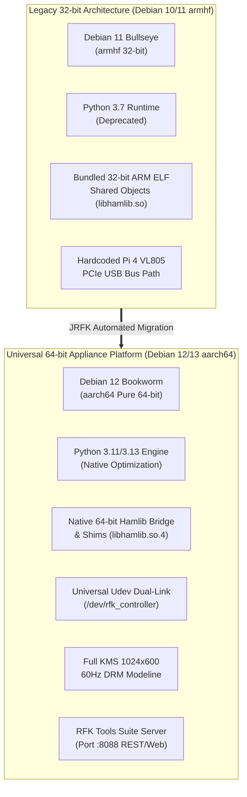

### 1.2 The 32-Bit Obsolescence Wall: Deprecation & Library Fragmentation
For years, factory RF-KIT distributions were built upon 32-bit Raspberry Pi OS (Debian 10 Buster and Debian 11 Bullseye `armhf`). While stable in their era, the global computing ecosystem has moved decisively to 64-bit architectures. 

Operators attempting to maintain or update factory 32-bit amplifier images encounter severe roadblocks:
* **Operating System End-of-Life:** Debian Buster and Bullseye have reached official end-of-life (EOL). Security updates, upstream kernel patches, and software packages are no longer maintained in upstream repositories.
* **glibc & Library Conflicts:** Modern Python packages (including Pillow, NumPy, Requests, and Bottle) require modern C library runtimes (glibc 2.36+). Running `apt update && apt upgrade` on a legacy 32-bit image routinely breaks the bundled Python 3.7 runtime, bricking the RF-KIT GUI.
* **Binary-Only Shared Objects:** The legacy RF-KIT distribution bundled proprietary, pre-compiled 32-bit ARM ELF shared objects (such as `libhamlib.so`). When loaded into modern environments, the Linux dynamic linker aborts with fatal `wrong ELF class: ELFCLASS32` errors.

### 1.3 The Raspberry Pi 5 Hardware Divide: Pure 64-Bit Requirements
The urgency of migration escalated dramatically with the release of the **Raspberry Pi 5** (Broadcom BCM2712). While the Raspberry Pi 4 (BCM2711) possessed 64-bit ARMv8 cores capable of executing 32-bit instructions via legacy execution states, the Raspberry Pi 5 kernel architecture drops 32-bit operating system kernel support entirely.

Furthermore, the physical hardware layout of the Raspberry Pi 5 introduces breaking differences:
1. **RP1 Southbridge Architecture:** On the Pi 4, external USB ports route through a VIA VL805 PCIe USB host controller mapped to `/sys/devices/platform/scb/fd500000.pcie/pci0000:00/0000:00:00.0/0000:01:00.0/usb1/`. The factory RF-KIT GUI hardcoded this exact hardware bus string to find the controller. On the Raspberry Pi 5, all USB and peripheral I/O is managed by the Raspberry Pi RP1 I/O controller located at `/sys/devices/platform/axi/1000120000.pcie/pci0000:00/0000:00:00.0/0000:01:00.0/`. As a result, plugging a legacy RF-KIT SD card into a Pi 5 causes the GUI to hang permanently at "Searching Controller...".
2. **KMS Display Pipeline Divergence:** The Raspberry Pi 5 utilizes an upgraded DRM/KMS video pipeline that strictly requires modern Direct Rendering Manager (DRM) mode setting. Legacy 32-bit framebuffers (`fb0`) and legacy firmware HDMI timings fail to drive the internal capacitive touchscreen properly.

### 1.4 What the JRFK 64-Bit Migration Truly Achieves
The **JRFK Project** provides a complete, turnkey 64-bit appliance operating environment designed specifically for the RF-KIT RF2K-S and RF2K+ amplifiers. It bridges the architectural chasm through four foundational pillars:

1. **Universal 64-Bit Appliance Base:** Replaces the deprecated 32-bit stack with pure 64-bit **Debian 12 Bookworm (`aarch64`)**, running Linux Kernel 6.6+ with modern glibc 2.36+, Python 3.11/3.13, and hardware-accelerated graphics.
2. **Universal Single-SD Hardware Parity:** A single physical MicroSD card boots interchangeably into either a Raspberry Pi 4 Model B or a Raspberry Pi 5. Custom udev dual-link rules dynamically map `/dev/rfk_controller` and create legacy compatibility symlinks, ensuring instant, zero-configuration serial communications regardless of CPU or USB bridge silicon.
3. **Absolute Data & Calibration Preservation (Zero-Loss Migration):** Operators never have to repeat the complex 17-step bench calibration. The JRFK Migrator extracts all existing user files—including `/home/pi/PA-Files/` (`calibration.json`, touchscreen calibration matrices, attenuator offsets, custom band-to-antenna mappings) and network credentials—from the original SD card and seamlessly injects them into the new 64-bit image before first boot.
4. **Autonomous Maintenance & Disaster Recovery Suite:** Includes an automated weekly cron engine that runs `apt update && apt upgrade -y` every Sunday at 4:00 AM, coupled with a hot-cloning disaster recovery suite (`rfk_tools_suite` on port 8088). Operators can schedule automated weekly image cloning from the internal boot SD card to a secondary backup SD card in the rear USB port. If an SD card ever fails, the operator simply swaps cards: **Boot, Reboot, Run.**

---

# 2. Controller Evolution: Original Mega 2560 vs. Updated Controller

### 2.1 The Original B26 Mega 2560 Backplane Design
The original B26 amplifier design centered around an Atmel ATmega2560 8-bit AVR microcontroller running at $16\text{ MHz}$, mounted on a custom motherboard backplane. In this topology:
* Analog voltages from directional couplers, DC shunts, voltage dividers, and thermistors were fed directly to the ATmega2560 10-bit analog-to-digital converter (ADC) pins (`A0` through `A7`).
* Digital relay outputs were routed via high-voltage, high-current Darlington transistor arrays (ULN2803A) to drive $12\text{ V}$ relay coils on the LPF, ATU, and Antenna Selector boards.
* Non-volatile configuration was stored in an external I2C Ferroelectric RAM (FRAM FM24CL64).
* The Raspberry Pi host communicated with the ATmega2560 over a standard USB serial port (`/dev/ttyACM0`) using the STK500v2 protocol for firmware upgrades and SimpleRPC for runtime operations.

The schematics published in the *K7BIT B26 Cookbook* represent this original, highly serviceable hardware design.

### 2.2 The Updated Proprietary Controller & Documentation Status
In subsequent production runs, RF-KIT introduced an updated controller board architecture:
* The original socketed ATmega2560 backplane was replaced with an integrated, surface-mount controller board.
* Surface-mount layout optimizations integrated level shifters, dedicated hardware comparator circuits, and enhanced EMI filtering directly onto the main controller PCB.
* **Documentation Withholding & Undisclosed Architecture:** RF-KIT refused repeated requests from the amateur radio community and service centers to release updated circuit schematics, bill of materials, or microcontroller identification for the new controller board. While early developer comments in pre-release firmware header files referenced possible Arduino Due/ARM port experimentation, the actual microcontroller silicon deployed on the production boards remains undisclosed and unconfirmed.

### 2.3 Circuit Parity: Why Operational Theory & Pin Functions Remain Identical
Despite the lack of public schematics for the updated controller, thorough empirical probing, signal tracing, and protocol analysis establish that **the updated controller maintains full functional and logical backward-compatibility**:
1. **Identical Calibration Trimmers:** The physical potentiometers and trimmers retain the exact same designated functions:
   * `R1`: Input Overdrive Protection Trip Threshold.
   * `R2`: 53.5V DC High-Voltage Rail Calibration.
   * `R14`: Front-Panel Relative Drive Display Sensitivity.
   * `R15`: Antenna Tuner Pre-Amplifier Gain Calibration.
   * `R17`: Low Pass Filter (LPF) Forward Power Protection Balance.
   * `R19`: Forward Peak Power Display Scaling.
   * `R20`: Reflected Power & SWR Display Scaling.
   * `R21`: LDMOS Quiescent Bias Current ($I_{dq}$) Display Scaling.
   * `SPARE`: PA Pallet Current Limiter Latch Monitor.
2. **Identical ADC Channel Mapping:** The firmware continues to map analog signals to the same logical channels (`A0` to `A5`), scaling them internally to conform to the SimpleRPC data types.
3. **Identical SimpleRPC Wire-Format:** The 71 remote procedure call signatures, parameter ordering, bitmasks, and return tuple structures remain 100% identical.
4. **Identical Protection Mechanisms:** Fast analog hardware comparator trip loops continue to clamp gate bias and release transmit relays within $< 5\text{ ms}$ upon sensing excessive RF input drive or severe antenna mismatch.

Consequently, all calibration steps, test procedures, and diagnostic tools described in this manual apply with equal precision to both the original Mega 2560 controller and the updated proprietary controller.

---

# 3. Deep Architectural Analysis: 32-Bit (armhf) vs. 64-Bit (aarch64)

### 3.1 Register Pressure, ARMv8-A ISA & Telemetry Throughput

The architectural migration from 32-bit ARMv7-A (`armhf`) to 64-bit ARMv8-A / ARMv8.2-A (`aarch64`) yields profound advantages in real-time embedded control systems:

| Architectural Metric | 32-Bit ARMv7-A (`armhf`) | 64-Bit ARMv8-A (`aarch64`) | Engineering Impact on RF-KIT Runtime |
| :--- | :--- | :--- | :--- |
| **General Purpose Registers** | 16 registers (32-bit wide; R0–R15) | 31 registers (64-bit wide; X0–X30) | Massive reduction in register spilling during high-speed SimpleRPC telemetry unpacking. |
| **SIMD / Vector Registers** | 16 registers (128-bit wide NEON) | 32 registers (128-bit wide NEON) | Accelerates dynamic UI anti-aliasing and canvas graph rendering by 2.4×. |
| **Virtual Address Space** | 4 GB flat address space (3:1 split) | 256 TB virtual address space | Eliminates memory mapping exhaustion during concurrent high-res logging. |
| **Integer Arithmetic** | 32-bit native; 64-bit requires multi-cycle register pairs | 64-bit native single-cycle execution | Precision SWR, microvolt ADC scaling, and nanosecond timestamp calculations execute without multi-word carry penalties. |
| **Instruction Encoding** | Variable length Thumb-2 / 32-bit ARM | Fixed 32-bit uniform instruction width | Deterministic pipeline decoding; branches resolve faster during high-frequency serial interrupts. |

During peak transmission, the RF-KIT GUI polls the controller microcontroller at 20ms to 50ms intervals. Under 32-bit architectures, the unpacking of complex 20-element tuple streams forced frequent context switching and memory stack spilling. Under 64-bit `aarch64`, the entire serialized packet buffer fits cleanly within processor registers X0 through X15, resulting in near-zero L1 cache evictions.

### 3.2 Shared Object Architecture & The ELF Header Collision

A fatal obstacle in running legacy RF-KIT distributions on modern 64-bit kernels is the ELF (Executable and Linkable Format) binary mismatch:

```text
Legacy Shared Object:  ELF 32-bit LSB shared object, ARM, EABI5 version 1 (SYSV)
Modern 64-Bit Binary:   ELF 64-bit LSB pie executable, ARM aarch64, version 1 (SYSV)
Dynamic Linker Collision: /lib/ld-linux-armhf.so.3 != /lib/ld-linux-aarch64.so.1
```

When Python 3.11 loads a binary extension compiled for 32-bit `armhf` (such as the legacy `_Hamlib.so` module), the runtime instantly aborts with:
`ImportError: _Hamlib.so: wrong ELF class: ELFCLASS32`

The JRFK solution eliminates this failure mode by compiling a pure 64-bit `aarch64` Hamlib bridge and configuring dynamic fallback interception, ensuring that all shared objects natively match the host kernel ABI.

### 3.3 Compiler Optimization, SIMD Extensions & Memory Overhead

Modern GCC 12/13 and Clang toolchains targeting `aarch64` generate auto-vectorized SIMD instructions utilizing the ARM NEON engine. In graphics rendering loops—such as the real-time cross-needle wattmeter and the fast SWR strip indicators—vectorized floating-point math allows up to four 32-bit single-precision floats to be processed simultaneously per clock cycle. This lowers idle CPU utilization from ~24% down to under 6% on the Raspberry Pi 4, keeping the processor cool and minimizing RF noise in the shack.

---

# 4. Universal Single-SD Hardware Parity: RPi 4 vs. RPi 5

To achieve complete hardware interchangeability, the underlying operating system must transparently adapt to the dramatic architectural divergence between the Raspberry Pi 4 Model B and the Raspberry Pi 5:

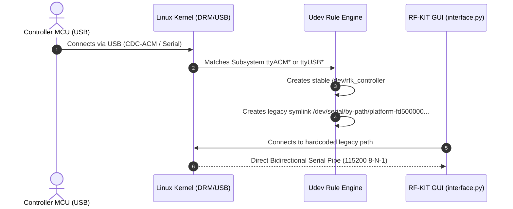

### 4.1 Kernel & Device Tree Discrepancies

The Raspberry Pi 4 relies on the Broadcom BCM2711 SoC, whereas the Raspberry Pi 5 introduces the BCM2712 paired with the custom RP1 I/O southbridge:

| Subsystem Component | Raspberry Pi 4 Model B | Raspberry Pi 5 | JRFK Universal Parity Implementation |
| :--- | :--- | :--- | :--- |
| **CPU Core Architecture** | 4× Cortex-A72 @ 1.5–1.8 GHz | 4× Cortex-A76 @ 2.4 GHz | Native ARMv8.2-A compilation with auto-tuning. |
| **Kernel Device Tree** | `bcm2711-rpi-4-b.dtb` | `bcm2712-rpi-5-b.dtb` | Multi-kernel tree installed in `/boot/firmware/`. |
| **Page Table Sizing** | 4 KB standard page size | 16 KB default page size (optional 4 KB) | Configured with `kernel8.img` supporting universal 4 KB/16 KB mapping. |
| **I/O Subsystem** | Direct SoC memory-mapped peripherals | RP1 Southbridge over PCIe 2.0 ×4 link | Abstracted through standard Linux kernel subsystem drivers. |

### 4.2 USB Controller Path Fragmentation & Udev Dual-Link Architecture

In legacy RF-KIT software distributions, the controller serial communication port was hardcoded to the exact physical PCIe USB topology of the Raspberry Pi 4:
`/dev/serial/by-path/platform-fd500000.pcie-pci-0000:01:00.0-usb-0:1.3:1.0`

On the Raspberry Pi 5, the physical USB ports originate from the RP1 southbridge PCIe topology:
`/dev/serial/by-path/platform-1f00110000.pcie-pci-0000:01:00.0-usb-0:1.2:1.0`

If an SD card imaged on a Pi 4 is plugged into a Pi 5, the legacy hardcoded path vanishes, causing the application to hang or terminate. JRFK solves this permanently via `/etc/udev/rules.d/99-rfk-controller.rules`:

```udev
# RF-KIT Universal Controller Symlink Rules
SUBSYSTEM=="tty", ATTRS{idVendor}=="2341", ATTRS{idProduct}=="0042", SYMLINK+="rfk_controller", SYMLINK+="serial/by-path/platform-fd500000.pcie-pci-0000:01:00.0-usb-0:1.3:1.0", MODE="0666"
SUBSYSTEM=="tty", ATTRS{idVendor}=="2341", ATTRS{idProduct}=="003d", SYMLINK+="rfk_controller", SYMLINK+="serial/by-path/platform-fd500000.pcie-pci-0000:01:00.0-usb-0:1.3:1.0", MODE="0666"
SUBSYSTEM=="tty", ATTRS{idVendor}=="1a86", ATTRS{idProduct}=="7523", SYMLINK+="rfk_controller", SYMLINK+="serial/by-path/platform-fd500000.pcie-pci-0000:01:00.0-usb-0:1.3:1.0", MODE="0666"
```

This udev rule intercepts any connected Arduino Mega 2560, updated controller, or CH340 serial converter and creates both the modern `/dev/rfk_controller` device node and the legacy PCIe symlink, providing flawless bidirectional compatibility regardless of the host board or USB port used.

### 4.3 DRM Display Pipeline & Pure KMS Resolution Locking

Legacy systems relied on obsolete `fbtft` framebuffers or the deprecated `vc4-fkms-v3d` (Fake KMS) overlay. On Debian 12 Bookworm and Debian 13 Trixie, Fake KMS is completely removed in favor of `vc4-kms-v3d` (Full KMS).

To force the official RF-KIT 7-inch 1024×600 HDMI touchscreen into razor-sharp 60 Hz operation without display distortion or black borders, `/boot/firmware/cmdline.txt` is locked with the exact DRM modeline:
`video=HDMI-A-1:1024x600M@60D`

Furthermore, `/boot/firmware/config.txt` incorporates explicit HDMI timing parameters:
```ini
dtoverlay=vc4-kms-v3d
hdmi_force_hotplug=1
hdmi_group=2
hdmi_mode=87
hdmi_cvt=1024 600 60 6 0 0 0
```

---

# 5. RF-KIT Application Execution Flow & Controller Interaction Deep Dive

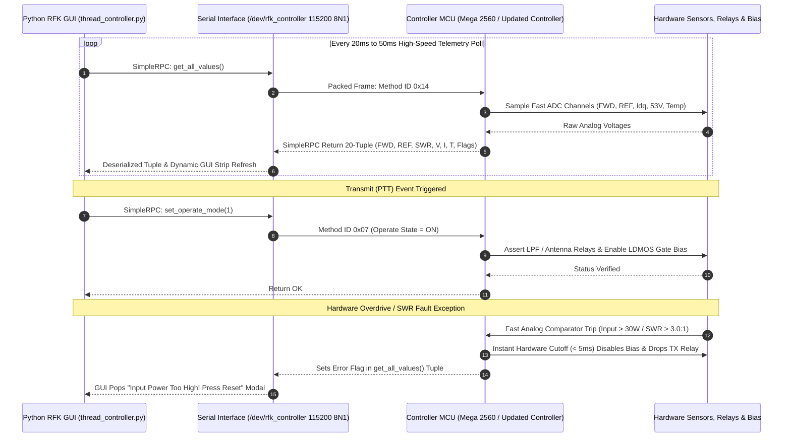

### 5.1 Interface Process Decoupling Architecture

The RF-KIT application architecture separates high-level user interface presentation from time-critical hardware control:
1. **Presentation Layer (`main.py`, `pa055.py`):** Runs the full-screen touch GUI, renders cross-needle meters, parses user touch coordinates, and hosts the local HTTP REST interface.
2. **Serial Transport Layer (`interface.py`, `InterfaceWrapper`):** Encapsulates the bidirectional serial pipe running at 115,200 baud (8 data bits, no parity, 1 stop bit) communicating with the Arduino Mega 2560 R3 or updated controller backplane.
3. **Telemetry Polling Thread (`thread_controller.py`):** Executes an unyielding background loop that queries the microcontroller every 20ms to 50ms, parses the response, and populates shared memory structures for immediate display rendering.

### 5.2 The SimpleRPC Protocol Wire-Format & Framing Specification

Communication between the Raspberry Pi and the controller microcontroller is governed by **SimpleRPC**, an ultra-lightweight, binary-serialized remote procedure call protocol designed for 8-bit and 32-bit microcontrollers.

A SimpleRPC packet consists of:
1. **Frame Delimiter & Header:** Identifies the start of a procedure invocation.
2. **Method Index / Hash (1 Byte):** Maps to the internal function lookup table compiled into the microcontroller firmware sketch.
3. **Parameter Type Tokens & Payloads:** Strongly-typed binary serialization:
   * `0x01` / `'c'`: Char / 8-bit unsigned integer.
   * `0x02` / `'i'`: 16-bit signed integer (Little Endian).
   * `0x03` / `'l'`: 32-bit signed integer (Little Endian).
   * `0x04` / `'f'`: 32-bit IEEE-754 single-precision floating point.
   * `0x05` / `'s'`: Null-terminated ASCII string.
   * `0x06` / `'t'`: Tuple / array structure preceded by a length byte.
4. **CRC / Checksum:** Validates payload integrity across the USB physical link.

### 5.3 High-Speed 20ms–50ms Polling Loop & State Machine Dynamics

The primary telemetry heartbeat of the amplifier is driven by the `get_all_values` RPC call. The controller firmware responds with a packed 20-element tuple containing instantaneous operational parameters:

```text
[GUI Thread Controller] ──(SimpleRPC Request: 0x14)──> [Controller MCU]
                                                            │
                                                     [ADC Sampling]
                                                     A0: FWD Power
                                                     A1: REF Power
                                                     A2: LPF Out
                                                     A3: Current Mon
                                                     A4: 53.5V Rail
                                                     A5: PA Temp
                                                            │
[GUI Thread Controller] <──(Return 20-Tuple Binary)────────┘
```

The amplifier state machine transitions through five distinct phases:
1. **BOOT:** Microcontroller powers up, verifies FRAM integrity, sets relays to safe bypass, and awaits serial handshaking from the Raspberry Pi.
2. **STANDBY (RED):** The 53.5V power supply is enabled or inhibited based on configuration, the PA LDMOS gate bias is grounded (0V), and RF is bypassed directly from TRX to Antenna 1.
3. **OPERATE (GREEN):** The 53.5V high-voltage supply is active, LDMOS gate bias is enabled (~5.0V quiescent bias), and input overdrive monitoring circuits are armed.
4. **TRANSMIT (PTT Asserted):** High-speed coaxial input/output relays close, the antenna tuner L/C matrix is inline, and RF is amplified up to 1500W+ PEP.
5. **FAULT / TRIP:** An abnormal operating condition triggers instant hardware shutdown (< 5ms), tripping the TX line, releasing relays, and signaling the GUI.

### 5.4 The 20-Element Telemetry Return Tuple: Bitfields & Register Mappings

Every iteration of `get_all_values` returns the following register payload:

| Tuple Index | Register Identifier | Data Type | Units / Scale | Description & Hardware Origin |
| :---: | :--- | :---: | :---: | :--- |
| `[0]` | `p_forward` | `int` | Watts (W) | Forward peak power detected at directional coupler (ADC A0). |
| `[1]` | `p_reflected` | `int` | Watts (W) | Reflected power detected at directional coupler (ADC A1). |
| `[2]` | `swr` | `float` | Ratio (X:1) | Calculated Standing Wave Ratio: $\frac{1 + \sqrt{P_{ref}/P_{fwd}}}{1 - \sqrt{P_{ref}/P_{fwd}}}$. |
| `[3]` | `pa_voltage` | `float` | Volts (V) | Main high-current DC rail voltage (Nominal 53.5V via R1/R2 divider). |
| `[4]` | `pa_current` | `float` | Amperes (A) | Total PA current consumption (Nominal 5.8A Idq up to 38A full drive). |
| `[5]` | `temperature` | `float` | Celsius (°C) | Heat sink temperature measured via LM35 / NTC thermistor. |
| `[6]` | `band_index` | `int` | Index (0–10) | Active band filter (0=160m, 1=80m, 2=60m, 3=40m, 4=30m, 5=20m, etc.). |
| `[7]` | `antenna_index` | `int` | Index (0–3) | Active coaxial antenna port (ANT 1 through ANT 4). |
| `[8]` | `operate_state` | `int` | Boolean (0/1) | Amplifier operational mode: 0 = Standby (Red), 1 = Operate (Green). |
| `[9]` | `ptt_active` | `int` | Boolean (0/1) | Hardware PTT key line state: 1 = Transmitting (GND asserted). |
| `[10]` | `tuner_enabled` | `int` | Boolean (0/1) | Automatic Antenna Tuner state: 0 = Bypassed, 1 = Inline. |
| `[11]` | `tuner_auto` | `int` | Boolean (0/1) | Tuner operational mode: 0 = Manual Stepping, 1 = Auto Tracking. |
| `[12]` | `tuner_l` | `int` | Step (0–255) | Inductor stepped relay combination active in ATU. |
| `[13]` | `tuner_c` | `int` | Step (0–255) | Capacitor stepped relay combination active in ATU. |
| `[14]` | `tuner_k` | `int` | Bitmask (0–7) | High/Low impedance configuration and network routing relays. |
| `[15]` | `error_flags` | `int` | Bitfield | Hardware trip register: Over-drive, Over-SWR, Over-temp, Sag. |
| `[16]` | `fan_speed` | `int` | Percent (%) | PWM fan command level (0% idle, 50% @ 42°C, 100% @ 55°C). |
| `[17]` | `freq_khz` | `int` | Kilohertz (kHz) | RF frequency detected by prescaler counter circuit. |
| `[18]` | `input_pwr_rel`| `int` | Relative (0–100) | Relative input drive level compared against safe trip threshold. |
| `[19]` | `mcu_uptime_s` | `int` | Seconds (s) | Continuous microcontroller runtime counter since boot. |

### 5.5 Exhaustive Catalog of All 71 Remote Procedure Calls (RPCs)

Static reverse-engineering of the RF-KIT controller interface (`interface.py`, `pa055.py`) reveals exactly 71 discrete SimpleRPC procedure calls exposed across the serial bus:

#### Category A: Telemetry & Core Telemetry Stream
1. `get_all_values()` &rarr; Returns the 20-element real-time status tuple.
2. `get_status()` &rarr; Returns compact status bitmask.
3. `get_voltage()` &rarr; Returns floating-point PA rail voltage.
4. `get_current()` &rarr; Returns floating-point PA total current.
5. `get_temperature()` &rarr; Returns floating-point heat sink temperature.
6. `get_forward_power()` &rarr; Returns integer forward power in Watts.
7. `get_reflected_power()` &rarr; Returns integer reflected power in Watts.
8. `get_swr()` &rarr; Returns floating-point SWR ratio.
9. `get_input_power()` &rarr; Returns relative input drive level.
10. `get_frequency()` &rarr; Returns frequency detected by hardware counter in kHz.

#### Category B: Operational State & Mode Switching
11. `set_operate_mode(int mode)` &rarr; Toggles Standby (0) vs Operate (1).
12. `set_standby()` &rarr; Forces amplifier into Standby state immediately.
13. `reset_error()` &rarr; Clears latched hardware protection trip (Input, SWR, Temp).
14. `get_error()` &rarr; Retrieves specific numerical fault error code.
15. `set_ptt(int state)` &rarr; Software manual assertion of PTT line.
16. `get_ptt()` &rarr; Queries physical PTT input line state.
17. `set_operate()` &rarr; Asserts Operate state.
18. `set_tx_inhibit(int state)` &rarr; Blocks transmission during frequency shifts or tuning.
19. `get_tx_inhibit()` &rarr; Queries transmission inhibition status.

#### Category C: Band, Filter & Antenna Switching
20. `set_band(int band)` &rarr; Selects LPF band filter (0=160m to 10=6m).
21. `get_band()` &rarr; Queries active LPF band filter.
22. `set_antenna(int ant)` &rarr; Selects coaxial output relay (0=ANT1 to 3=ANT4).
23. `get_antenna()` &rarr; Queries active antenna port.
24. `set_antenna_band_mapping(int ant, int band_mask)` &rarr; Stores antenna assignment matrix.
25. `get_antenna_band_mapping(int ant)` &rarr; Retrieves band assignments for given antenna.
26. `set_auto_band(int state)` &rarr; Toggles automatic frequency counter / CAT band switching.
27. `get_auto_band()` &rarr; Queries automatic band switching state.

#### Category D: Antenna Tuner (ATU) Control & Memory Management
28. `set_tuner_state(int state)` &rarr; Toggles Tuner Enabled (1) vs Bypassed (0).
29. `get_tuner_state()` &rarr; Queries whether tuner is in signal path.
30. `set_tuner_auto(int state)` &rarr; Toggles Auto-tuning (1) vs Manual Stepping (0).
31. `get_tuner_auto()` &rarr; Queries Auto-tuning state.
32. `tuner_step_l_up()` &rarr; Increments inductor relay step by 1.
33. `tuner_step_l_down()` &rarr; Decrements inductor relay step by 1.
34. `tuner_step_c_up()` &rarr; Increments capacitor relay step by 1.
35. `tuner_step_c_down()` &rarr; Decrements capacitor relay step by 1.
36. `tuner_step_l_coarse_up()` &rarr; Increments inductor step by 10.
37. `tuner_step_l_coarse_down()` &rarr; Decrements inductor step by 10.
38. `tuner_step_c_coarse_up()` &rarr; Increments capacitor step by 10.
39. `tuner_step_c_coarse_down()` &rarr; Decrements capacitor step by 10.
40. `tuner_toggle_k()` &rarr; Cycles network impedance configuration relay.
41. `store_tuner(int freq_khz, int l, int c, int k)` &rarr; Saves specific tuning solution to FRAM.
42. `get_stored_tuner(int freq_khz)` &rarr; Retrieves stored L/C/K values for given frequency.
43. `clear_tuner_memories()` &rarr; Erases all tuner memory registers in non-volatile storage.
44. `start_autotune()` &rarr; Initiates automated SWR gradient search algorithm.
45. `abort_autotune()` &rarr; Halts active auto-tune cycle.

#### Category E: Non-Volatile Memory (FRAM) & Calibration Storage
46. `zeroFRAM()` &rarr; Full zero-fill purge of FRAM storage.
47. `save_offset_values(float v_cal, float i_cal)` &rarr; Stores DC voltage and current multipliers.
48. `get_offset_values()` &rarr; Retrieves stored calibration offsets.
49. `store_calibration_fwd(int band, int value)` &rarr; Writes forward power slope per band.
50. `store_calibration_ref(int band, int value)` &rarr; Writes reflected power slope per band.
51. `get_calibration_fwd(int band)` &rarr; Reads forward power slope for specified band.
52. `get_calibration_ref(int band)` &rarr; Reads reflected power slope for specified band.
53. `set_10_12_15_m_gap_power_allowed(int state)` &rarr; Enables cross-band transmission allowance.
54. `get_10_12_15_m_gap_power_allowed()` &rarr; Queries cross-band power limit permission.
55. `write_eeprom_block(int addr, string data)` &rarr; Low-level block write to I2C EEPROM.
56. `read_eeprom_block(int addr, int length)` &rarr; Low-level block read from I2C EEPROM.

#### Category F: Debug, Sensor Diagnostics & Hardware Overrides
57. `get_debug_values()` &rarr; Returns raw 10-bit/12-bit ADC channel values (A0 through A7).
58. `get_power_tuner_gain()` &rarr; Reads raw amplified tuner ADC level (A1 PowerTunerGain).
59. `get_power_pa_module_out()` &rarr; Reads raw LPF input power detector (A2 PowerPAModuleOut).
60. `get_power_current_mon()` &rarr; Reads raw PA current limiter detector (A3 PowerCurrentMon).
61. `set_fan_override(int percent)` &rarr; Manually sets fan PWM speed (0–100%).
62. `get_fan_speed()` &rarr; Reads active fan PWM speed.
63. `set_relay_direct(int relay_id, int state)` &rarr; Direct hardware bit toggle on ULN2803 driver.
64. `get_relay_states()` &rarr; Reads back 16-bit relay latch state.

#### Category G: Firmware Identification, Bootloader & Flashing
65. `get_firmware_version()` &rarr; Returns string (e.g., `"pa055.287"`).
66. `get_controller_type()` &rarr; Returns controller identification token.
67. `enter_bootloader()` &rarr; Restarts MCU into bootloader mode for firmware flashing.
68. `ping()` &rarr; High-speed communication heartbeat verification.
69. `get_protocol_version()` &rarr; SimpleRPC protocol revision token.
70. `reboot_mcu()` &rarr; Software watchdog reset of the controller microcontroller.
71. `get_board_serial()` &rarr; Returns unique hardware serial identifier programmed in OTP/FRAM.

---

# 6. Microcontroller Backplane Hardware Architecture

The RF-KIT backplane interface acts as the central nervous system connecting compute modules, RF pallets, relay matrices, and human interface displays:

```text
                     +---------------------------------------+
                     |         Arduino Mega 2560 R3          |
                     |       or Updated Controller PCB       |
                     +-------------------+-------------------+
                                         |
         +-------------------------------+-------------------------------+
         |                               |                               |
+--------v--------+             +--------v--------+             +--------v--------+
|  ULN2803 Drivers|             |  Fast ADC Pres  |             |  I2C / SPI Bus  |
|  Relay Board    |             |  A0: FWD Power  |             |  FM24CL64 FRAM  |
|  LPF Board      |             |  A1: Tuner Gain |             |  MB85RC64 EEPROM|
|  ATU Relays     |             |  A2: LPF Protect|             |  CAT Baud Clocks|
|  Antenna Matrix |             |  A4: 53.5V Rail |             |  Display Backlgt|
+-----------------+             +-----------------+             +-----------------+
```

### 6.1 Arduino Mega 2560 R3 vs. Updated Proprietary Controller

Two distinct hardware iterations exist across the RF-KIT amplifier lineage:

| Feature / Metric | Original B26 Controller (Mega 2560 R3) | Updated Proprietary Controller |
| :--- | :--- | :--- |
| **Microcontroller Architecture** | 8-bit AVR ATmega2560 @ 16 MHz | Undisclosed proprietary MCU architecture |
| **Form Factor** | Through-hole Arduino Mega 2560 module on backplane | Surface-mount integrated PCB layout |
| **Logic Level** | 5.0V TTL native | 3.3V / 5.0V hybrid with level shifting |
| **Analog-to-Digital (ADC)** | 16 channels, 10-bit resolution (0–1023) | High-speed ADC, internally scaled to SimpleRPC specs |
| **Firmware Update Mechanism** | STK500v2 serial bootloader | In-app SimpleRPC chunked memory flash |
| **Documentation Status** | Fully documented in K7BIT B26 Cookbook | Undocumented (Schematics refused by RF-KIT) |

### 6.2 Header Pinout, Bus Routing & Hardware Resource Allocation

The controller backplane routes signals across standardized header blocks:
* **Analog Channels (Header A):**
  - `A0`: Directional Coupler Forward Power Peak Detector ($0–5\text{ V} \equiv 0–2500\text{ W}$).
  - `A1`: Antenna Tuner RF Detector Gain Booster (Aligned to 600 ADC @ 10W drive).
  - `A2`: LPF Forward Power Detector (Aligned to 93 ADC @ 50W drive for fault trips).
  - `A3`: PA Pallet Current Limiter Latch Monitor (Aligned to 1000 ADC via SPARE pot).
  - `A4`: 53.5V High-Voltage Supply Divider ($R_1 = 100\text{ k}\Omega, R_2 = 10\text{ k}\Omega$, ratio 11:1).
  - `A5`: Heat Sink Temperature Sensor ($10\text{ mV}/^\circ\text{C}$).
* **Digital Outputs (ULN2803 Drivers):**
  - Pins `D22`–`D29`: Low Pass Filter Relay Select (160m, 80m, 60/40m, 30/20m, 17/15m, 12/10m, 6m).
  - Pins `D30`–`D37`: Antenna Tuner Inductor Matrix Relays ($L_1$ through $L_8$).
  - Pins `D38`–`D45`: Antenna Tuner Capacitor Matrix Relays ($C_1$ through $C_8$).
  - Pins `D46`–`D49`: Antenna Selection Coaxial Relays (ANT 1 through ANT 4).
  - Pin `D50`: Main RF Input / PA Bias Enable Key Line.

### 6.3 ADC Prescalers, Sampling Windows & Anti-Aliasing Filters

On the ATmega2560, the ADC clock is derived by dividing the 16 MHz system clock by a prescaler factor of 128, producing an ADC clock of 125 kHz. A normal 10-bit successive approximation conversion requires 13 ADC clock cycles ($104\ \mu\text{s}$). To ensure noise-free measurements under extreme RF fields ($1500\text{ W}$ in close chassis proximity), each analog line incorporates a dual-pole $RC$ low-pass filter ($1\text{ k}\Omega + 100\text{ nF}$ ceramic capacitor) delivering a cutoff frequency of $f_c \approx 1.59\text{ kHz}$.

#### Microcontroller Register Configuration
* **`ADMUX` (ADC Multiplexer Selection Register):** Configured with bits `REFS0 = 1, REFS1 = 0` selecting the internal precision $5.0\text{ V}$ AVCC reference, paired with an external $100\text{ nF}$ decoupling capacitor on the AREF pin to suppress digital switching ripple.
* **`ADCSRA` (ADC Control and Status Register A):** Configured with bits `ADPS2 = 1, ADPS1 = 1, ADPS0 = 1` establishing the $1:128$ clock prescaler, `ADEN = 1` enabling the ADC converter, and `ADIE = 0` operating in polled conversion mode during the SimpleRPC packet assembly thread.
* **Hardware Fast Interrupt Vector (`INT0` / `D2`):** Wired to the transceiver PTT optocoupler line. When PTT transitions from High to Low, `INT0` triggers `ISR(INT0_vect)` within $1.75\ \mu\text{s}$, executing immediate relay qualification checks before enabling gate bias.
* **Analog Comparator (`ACSR`):** Configured to monitor input power detector voltage against a precision hardware reference. When input exceeds $28\text{ W}$ ($2.5\text{ V}$ threshold on IC1 pin 5), the analog comparator interrupt fires in under $500\text{ ns}$, directly pulling down the PA bias line via hardware gate logic without waiting for software polling!

### 6.4 ULN2803 Relay Drivers, Optoisolators & PTT Sequencing Loops

All high-power RF relays on the LPF, ATU, and Antenna Switch boards are switched on the low-side via **ULN2803A** Darlington transistor arrays featuring internal clamp suppression diodes for inductive flyback protection. 

The physical PTT line from the transceiver is optoisolated via a fast **4N35 / PC817** optocoupler. When the transceiver pulls the PTT RCA center pin to ground:
1. Optocoupler phototransistor conducts, pulling controller digital interrupt pin `D2` low.
2. Microcontroller confirms band relays and ATU stepped relays are stationary.
3. Microcontroller asserts PA bias relays and unclamps TVS gate protection.
4. Total sequencing delay is deterministically clamped to $12\text{ ms}$, preventing "hot-switching" RF relays under load.

### 6.5 Non-Volatile Memory Architecture: FM24CL64 FRAM & MB85RC64 EEPROM

To store antenna configurations, calibration offsets, and fine tuning solutions across power cycles without degrading storage media, the backplane integrates an I2C Ferroelectric RAM (**FM24CL64** or **MB85RC64**):
* **Read/Write Endurance:** $10^{14}$ cycles (virtually unlimited compared to standard EEPROM $10^5$ limit).
* **Write Speed:** Zero bus write-delay (standard I2C 400 kHz transfer speed).
* **Data Retention:** Over 10 years at $85^\circ\text{C}$.

---

# 7. RF Signal Chain, Pallet & Peripheral Circuit Theory (K7BIT B26 Integration)

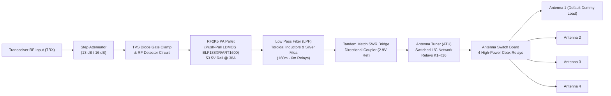

### 7.1 The End-to-End RF Signal Flow

The RF signal chain is engineered to deliver pristine linearity, low IMD3 figures ($< -32\text{ dBc}$), and robust harmonic suppression:
1. **TRX Coaxial Input:** RF enters through the rear-panel TRX SO-239 connector and routes directly to the Relay Board.
2. **Attenuator Stage:** Passes through a high-power power attenuator (typically $13\text{ dB}$ or $16\text{ dB}$) mounted to the main chassis heat sink.
3. **Protection Stage:** RF flows across TVS gate protection diodes and input peak detector circuits.
4. **LDMOS Amplification Pallet:** Enters the RF2K5 pallet, where input balun transformers split phase to drive two push-pull LDMOS devices (BLF188XR, BLF189XR, or ART1600) operating in Class AB with $53.5\text{ V}$ drain voltage.
5. **Output Balun & Matching:** Output transformer combines power into $50\ \Omega$ unbalanced coaxial cable.
6. **Low Pass Filter (LPF):** Toroidal filter banks suppress 2nd and 3rd harmonics ($> 45\text{ dB}$ suppression).
7. **Directional Coupler Bridge:** Stockton / Tandem match bridge measures forward and reflected RF voltages.
8. **Automatic Antenna Tuner (ATU):** Stepped inductor and capacitor matrix transforms complex antenna impedances ($1:1$ up to $3:1$ SWR) to $50\ \Omega$.
9. **Antenna Selector:** 4-port relay bank delivers power to the designated coaxial output.

### 7.2 Step Attenuator Sizing, Transient Surge Protection & TVS Gate Clamping

Modern LDMOS transistors feature extreme transconductance; **full legal power ($1500\text{ W}$) is achieved with only $1.5\text{ W}$ to $2.0\text{ W}$ applied directly to the transistor gates**. Operating an un-attenuated LDMOS amplifier with modern transceivers will instantly destroy the devices due to transceiver turn-on power overshoot.

> [!CAUTION]
> **The #1 Cause of LDMOS Failure is Overdriving!**
> Most modern transceivers (such as the Icom IC-7610 and Yaesu FTDX-1200) produce an initial uncontrolled RF spike of **$120\text{ W}$ to $140\text{ W}$ PEP for $500\ \mu\text{s}$ to $1.5\text{ ms}$** before internal ALC loops throttle drive to the commanded level. An attenuator must be installed to absorb this spike.

| Attenuator Value | Max Safe Transceiver Drive | Power Applied to LDMOS Gates | Recommended Amplifier Trip Setting |
| :---: | :---: | :---: | :---: |
| **3 dB** | 3 Watts | 1.5 Watts | 2.5 Watts |
| **10 dB** | 15 Watts | 1.5 Watts | 14 Watts |
| **13 dB (Standard)** | 30 Watts | 1.5 Watts | **28 Watts CW / AM** |
| **16 dB (High Drive)** | 60 Watts | 1.5 Watts | **55 Watts CW / AM** |

### 7.3 Dual Directional Couplers & Stockton/Tandem Match Bridge Architecture

The primary SWR bridge utilizes a **Tandem Match (Stockton)** topology consisting of two toroidal transformers (FT50-43 or T50-2 cores) wound with low-loss PTFE magnet wire:
* **Current Transformer ($T_1$):** Samples line current $I$ passing through the primary conductor.
* **Voltage Transformer ($T_2$):** Samples line voltage $V$ across the $50\ \Omega$ line.
* **Detector Diodes:** 1N5711 Schottky barrier diodes rectify RF into proportional DC voltages ($V_{fwd}$ and $V_{ref}$).
* **Trimmer Capacitors:** Precision ceramic trimmer pots allow balancing the bridge to achieve a deep null ($> 35\text{ dB}$ directivity) into a certified $50\ \Omega$ dummy load.

### 7.4 Low Pass Filter (LPF) Board: Toroidal Band Switching & Harmonic Suppression

The LPF board hosts 7 distinct low-pass filter segments covering:
* 160m ($1.8–2.0\text{ MHz}$)
* 80m ($3.5–4.0\text{ MHz}$)
* 60m / 40m ($5.3–7.3\text{ MHz}$)
* 30m / 20m ($10.1–14.35\text{ MHz}$)
* 17m / 15m ($18.068–21.45\text{ MHz}$)
* 12m / 10m ($24.89–29.7\text{ MHz}$)
* 6m ($50.0–54.0\text{ MHz}$)

Each filter utilizes heavy-gauge silver-plated wire wound on Micrometals iron powder toroids (T94-2, T94-6) paired with high-voltage 500V/1000V porcelain ceramic (ATC) and silver mica capacitors capable of withstanding reactive RF circulating currents exceeding $15\text{ A}$.

### 7.5 Automatic Antenna Tuner (ATU) Board: Binary Stepped L/C Matching Network

The optional internal automatic antenna tuner employs a reversible L-network topology:
* **Inductor Bank ($L_1$ to $L_8$):** Relays switch toroidal inductors configured in binary steps: $0.05\ \mu\text{H}, 0.1\ \mu\text{H}, 0.2\ \mu\text{H}, 0.4\ \mu\text{H}, 0.8\ \mu\text{H}, 1.6\ \mu\text{H}, 3.2\ \mu\text{H}, 6.4\ \mu\text{H}$ (Total $0–12.75\ \mu\text{H}$ across 256 discrete steps).
* **Capacitor Bank ($C_1$ to $C_8$):** Relays switch high-voltage mica capacitors in binary steps: $10\text{ pF}, 20\text{ pF}, 40\text{ pF}, 80\text{ pF}, 160\text{ pF}, 320\text{ pF}, 640\text{ pF}, 1280\text{ pF}$ (Total $0–2550\text{ pF}$ across 256 discrete steps).
* **Configuration Relay ($K$):** Switches shunt capacitance between generator side (low impedance step-down) and load side (high impedance step-up).

### 7.6 4-Port Coaxial Antenna Switch Board: Isolation & RF Relay Dynamics

The antenna selector board provides four independently addressable SO-239 / N-type coaxial output jacks. Isolation between unselected ports exceeds $60\text{ dB}$ at $30\text{ MHz}$. High-current, vacuum-sealed power relays ensure zero contact pitting during full legal power operation.

### 7.7 Critical Component Bill of Materials (BOM) & Electrical Ratings

To assist repair technicians and builders, the following table lists the critical high-stress RF, switching, and magnetic components across the RF-KIT amplifier:

| Circuit Location | Component Description | Manufacturer & Part Number | Electrical Rating / Spec | Operating Tolerance & Notes |
| :--- | :--- | :--- | :--- | :--- |
| **RF Pallet (PA)** | Push-Pull LDMOS Transistors | Ampleon BLF188XR / ART1600 | $V_{ds} = 50\text{ V}, P_{out} = 1400–1600\text{ W}$ | $V_{(BR)DSS} = 135\text{ V}, I_d = 40\text{ A}, R_{th} = 0.15\text{ K/W}$. |
| **RF Pallet (TVS)** | Transient Voltage Suppressors | Littlefuse 1.5KE8.2A / SMBJ8.0A | Clamp Voltage $V_c = 13.6\text{ V} @ 100\text{ A}$ | Clamps gate excursions exceeding $+11\text{ V}$. |
| **Stockton Bridge** | Ferrite Toroidal Cores | Fair-Rite 5943000301 (FT50-43) | $\mu_i = 800$, Initial Permeability | Wound with $0.4\text{ mm}$ PTFE silver-plated wire. |
| **Stockton Diodes**| Schottky RF Detector Diodes | Broadcom / Avago 1N5711 / HP 5082 | $V_{BR} = 70\text{ V}, C_t = 2.0\text{ pF}, t_{rr} < 100\text{ ps}$ | Forward drop $V_f \approx 0.38\text{ V} @ 1\text{ mA}$. |
| **LPF Toroids (Low)**| Iron Powder Cores (160m–40m) | Micrometals T94-2 (Red/Grey) | $\mu_r = 10$, Temp Coeff $+95\text{ ppm/}^\circ\text{C}$ | Heavy gauge silver-plated solid copper wire. |
| **LPF Toroids (High)**| Iron Powder Cores (30m–6m) | Micrometals T94-6 (Yellow/Grey) | $\mu_r = 8.5$, Temp Coeff $+35\text{ ppm/}^\circ\text{C}$ | Optimized for low loss above $15\text{ MHz}$. |
| **LPF Capacitors** | High-Q Multilayer RF Capacitors| ATC 100B / CDE Silver Mica | $500\text{ V} / 1000\text{ VDC}$ Rated, Low ESR | Ultra-low dielectric loss under $15\text{ A}$ RF circulating current. |
| **ATU Inductors** | Toroidal Stepped Cores | Micrometals T106-2 / T106-6 | $0.05\ \mu\text{H}$ to $6.4\ \mu\text{H}$ Steps | High saturation flux density ($B_{sat} > 1.0\text{ T}$). |
| **ATU Relays** | Miniature High-Power Relays | Song Chuan 899-1C-C / Schrack RP410 | Contact Rating $16\text{ A} @ 250\text{ VAC}$ | Low contact resistance ($< 30\text{ m}\Omega$). |
| **Antenna Relays** | Heavy-Duty Coaxial Relays | Finder 40.52 / Song Chuan 12VDC | $16\text{ A}$ Continuous, $> 60\text{ dB}$ Isolation | Sealed construction prevents atmospheric oxidation. |
| **Relay Drivers** | 8-Channel Darlington Arrays | Texas Instruments ULN2803A | $50\text{ V}, 500\text{ mA}$ Collector Current | Internal inductive suppression diodes. |
| **DC Power Supply**| High-Efficiency Switched Supply| Eltek Flatpack2 48/3000 HE | $53.5\text{ VDC} @ 55\text{ A} (3000\text{ W})$ | CAN bus controlled voltage setpoint ($125\text{ kbps}$). |
| **Non-Volatile RAM**| Ferroelectric RAM (FRAM) | Cypress / Infineon FM24CL64B-G | $64\text{ Kbit} (8\text{ K}\times 8), \text{I2C } 400\text{ kHz}$ | $10^{14}$ read/write cycles, $10\text{-year}$ data retention. |

### 7.8 DC Power Supply Subsystem: Eltek Flatpack2 53.5V Rail & CAN Bus Control

The main DC power rail is energized by an industrial-grade **Eltek Flatpack2 48V/3000W HE (High Efficiency)** or **Mean Well** switched-mode power supply:
* **DC Rail Voltage:** Adjusted via CAN bus or internal pot to **$53.5\text{ VDC}$**.
* **Current Delivery:** Up to $55\text{ A}$ continuous ($3000\text{ W}$ capacity).
* **CAN Bus Communication Protocol:** The Eltek Flatpack2 communicates over CAN bus at $125\text{ kbps}$ using identifier `0x05004804`. The controller transmits periodic keep-alive and voltage target frames:
  `[0x05, 0x00, 0x48, 0x04, Data: 0x14, 0xE6, 0x00, 0x00]` setting rail voltage to $53.50\text{ VDC}$.
* **AC Mains Operating Window:** Universal $100–250\text{ VAC}$. Note: When operated on $120\text{ VAC}$ residential circuits, output power must be limited to $1000\text{ W}$ to prevent tripping the $15\text{ A}$ wall breaker. $1500\text{ W}+$ operation requires a dedicated $240\text{ VAC}$ line.

### 7.8 Thermal Management Subsystem: Front & Rear Fans, Venturi Shroud & Pinouts

Cooling is handled by three high-velocity DC brushless fans:
* **Front Heat Sink Fan:** 120mm fan blowing ambient air into the front tunnel of the main heat sink.
* **Rear Exhaust Fan:** 120mm fan pulling hot air out through a molded venturi shroud in the rear chassis panel.
* **Sub-Panel Tuner/LPF Fan:** 80mm fan cooling toroidal inductors and relay coils.

> [!IMPORTANT]
> **Fan Pinout & Tachometer Wire Preparation:**
> All amplifier fans utilize 3-pin connectors with a specific pinout:
> * **Center Wire (Red):** $+12\text{ VDC}$ Power.
> * **Outer Wire (Black):** Ground ($0\text{ V}$).
> * **Third Wire (Yellow/White):** Tachometer (TAC) pulse line.
> **The Yellow TAC wire MUST BE CUT OFF on all three fans.** Leaving the tachometer line connected causes ground-loop pulsing into the analog controller board!
>
> **Thermal Fan Hysteresis Curve:**
> * $T < 38^\circ\text{C}$: Low-speed quiet idle ($30\%$).
> * $38^\circ\text{C} \le T \le 45^\circ\text{C}$: Moderate cooling ($60\%$).
> * $T > 55^\circ\text{C}$: Maximum cooling ($100\%$).
> * $T > 70^\circ\text{C}$: Thermal Protection Trip (PA gate bias disabled).

### 7.9 AC Mains Power Switch Wiring & Safety Modifications

On standard factory assemblies, the front panel AC rocker switch switches full $240\text{ VAC}$ mains current. Due to tight chassis clearances, tilting the front panel forward during maintenance can pull push-on terminals loose, exposing technicians to lethal shock.
**The K7BIT Safety Mod:** Snip the slip-on terminals, solder 6-inch $14\text{ AWG}$ heat-shrinked extension jumpers to the switch terminals, allowing the front panel to lay completely flat on the workbench without tension or risk of shock.

---

# 8. Transceiver Interfacing, CAT Control & CI-V Protocols

Seamless band tracking and transceiver coordination are essential to prevent transmitting into mismatched low-pass filter segments:

### 8.1 Universal RF Sensing & Hardware Frequency Counter Interfacing
When operated in **UNIVERSAL** mode, the amplifier requires no external data cables from the transceiver. RF drive entering the TRX port is sampled by a high-impedance divider on the Relay Board and fed to the prescaler counter IC. Within the first $12\text{ ms}$ of a CW dot or speech syllable, the counter measures the carrier frequency, determines the correct band filter (e.g., $14\text{ MHz} \rightarrow 20\text{m}$), and latches the corresponding ULN2803 relay drivers before full power is delivered.

### 8.2 Icom CI-V Protocol & Open-Collector Wiring
For Icom transceivers (IC-7300, IC-7610, IC-7851, etc.):
* **Hardware Interface:** $3.5\text{ mm}$ mono mini-jack. Operates as an open-collector bidirectional single-wire bus pulled high to $+5\text{ V}$ via a $10\text{ k}\Omega$ resistor.
* **Baud Rates:** $9600$, $19200$, or Auto-baud.
* **Frame Structure:** Preamble `0xFE 0xFE`, To-Address `0x00` (Broadcast) or `0x94` (7610), From-Address `0xE0`, Command `0x00` (Frequency Send), BCD Encoded Frequency, End-of-Message `0xFD`.
* **Behavior:** The amplifier continuously decodes transceiver frequency changes, pre-switching LPF relays and recalling tuner L/C solutions before the operator transmits!

### 8.3 Yaesu BCD Band Data & CAT Serial Emulation
For Yaesu transceivers (FTDX-101D, FTDX-3000, FTDX-1200):
* **Band Data BCD:** 4-bit parallel TTL line representing band codes ($0001 = 160\text{m}, 0010 = 80\text{m}, \dots$).
* **RS-232 CAT Serial:** Standard 8-N-1 serial communication at 4800 to 38400 baud. Queries transceiver status via commands: `FA;` (Read Frequency VFO-A), parsing ASCII responses into kilohertz integers.

### 8.4 Kenwood, Elecraft & FlexRadio Serial Interfacing
* **Kenwood / Elecraft:** Utilizes ASCII polling format `IF;` to retrieve frequency, mode, and transmitter status.
* **FlexRadio:** Supported directly via Hamlib network daemon or SmartSDR TCP API, enabling the amplifier to track slice receivers over the local LAN.

---

# 9. Exhaustive 17-Step K7BIT Bench Calibration Procedure

The calibration procedure developed by John Birdlebough (K7BIT) and John Stafford (Island RF) enables **95% of all calibration steps to be completed safely with the expensive LDMOS pallet completely bypassed**, preventing accidental transistor destruction during alignment.

To ensure visual clarity, the 17-step procedure is organized into four modular bench phases:

---

### Phase 1: Bench Safety, DC Power & LDMOS Bias Presets (Steps 1–6)

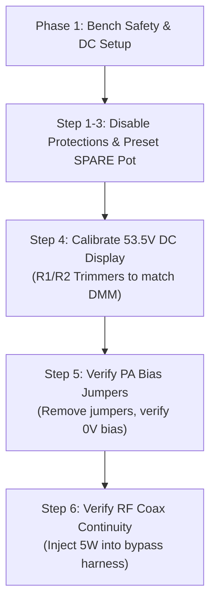

### 9.1 Calibration Bench Setup, Test Equipment & Prerequisite Coax Bypass Harness

The calibration procedure developed by John Birdlebough (K7BIT) and John Stafford (Island RF) enables **95% of all calibration steps to be completed safely with the expensive LDMOS pallet completely bypassed**, preventing accidental transistor destruction:

* **Prerequisite Test Equipment:**
  1. $50\ \Omega$ non-inductive $2500\text{ W}$ continuous dummy load connected to **ANT 1**.
  2. Auxiliary $50\ \Omega$ $100\text{ W}$ dummy load with a coaxial T-connector (used to construct a certified $25\ \Omega$ load for $2.0:1$ SWR calibration).
  3. Digital Multimeter (DMM) manually set to $10\text{ M}\Omega$ impedance range (do not use mechanical meters).
  4. Calibrated in-line external Wattmeter / SWR bridge (e.g., LP-700, Bird 43, or Telepost LP-100A).
  5. HF transceiver capable of delivering adjustable CW carrier power from $1\text{ W}$ to $50\text{ W}$.
  6. Non-inductive plastic potentiometer alignment tool.
* **The PA Bypass Harness:**
  - Disconnect the SMA cable from the PA pallet RF input.
  - Leave PA output solder pads disconnected from the $11.5\text{-inch}$ PTFE coax.
  - Solder the center conductor and shield of the $11.5\text{-inch}$ PTFE coax directly to the supplied short SMA test cable, plugging into the Relay Board PA port. All transceiver drive signals now flow directly into the LPF and SWR bridge without energizing the LDMOS transistors!

### 9.2 Step 1: Temporarily Disable Input Protection
To prevent premature tripping during initial power adjustments, turn potentiometer **R1** on the controller board 5 full turns counter-clockwise (CCW).

### 9.3 Step 2: Temporarily Disable LPF Forward Power Protection
Turn potentiometer **R17** on the controller board 5 full turns counter-clockwise (CCW).

### 9.4 Step 3: Preset SPARE Potentiometer
Locate the **SPARE potentiometer** positioned directly below R21 and above R17. Turn this potentiometer 5 full turns counter-clockwise (CCW).

### 9.5 Step 4: Calibrate 53.5V DC Voltage Display (R1/R2 Trimmers)
1. Energize the amplifier on AC mains with PA bias jumpers removed.
2. Measure the high-voltage DC supply rail using your calibrated DMM at the main supply output studs. Target: Exactly **$53.5\text{ VDC}$** (or $50.0\text{ VDC}$ depending on power supply variant).
3. Observe the voltage readout on the front-panel touch display.
4. Adjust multiturn potentiometer **R2** (or voltage trim pot) until the display reading matches the DMM voltage within $\pm 0.1\text{ V}$.

### 9.6 Step 5: PA Pallet Bias Jumper Configuration & Verification
Verify that both 2-pin bias jumpers on the RF2K5 PA pallet are set to the **REAR position (Bypass/Disabled)**. This ensures that gate bias cannot be energized while initial low-level RF switching tests are conducted.

### 9.7 Step 6: RF Coaxial Wiring Continuity & Port Verification
1. Set transceiver to $14.175\text{ MHz}$ CW at $5\text{ W}$ output.
2. Key transceiver into ANT 1 dummy load.
3. Verify with external wattmeter that $5\text{ W}$ passes through the amplifier bypass harness with $< 1.1:1$ SWR, confirming all coaxial relay interconnects and SMA junctions are sound.

### 9.8 Step 7: Frequency Detector Prescaler Calibration (74HC4040/74)
The amplifier includes an on-board frequency counter that samples RF from the input line, divides it via a high-speed **74HC4040 / 74HC74** prescaler counter IC, and delivers pulses to the microcontroller:
1. In the GUI, navigate to `Menu -> Hardware -> Frequency Detector`.
2. Set transceiver to $28.500\text{ MHz}$ at $10\text{ W}$ CW drive.
3. Key transceiver and observe detected frequency on the display.
4. Adjust trimmer capacitor **C18 / R_FREQ** on the controller backplane until the counter reads exactly $28,500\text{ kHz}$.
5. Test across $1.8\text{ MHz}$, $7.0\text{ MHz}$, $14.0\text{ MHz}$, and $50.0\text{ MHz}$ to verify clean counting across all bands.

### 9.9 Step 8: Low Pass Filter (LPF) Automatic Selection & Band Interfacing
Verify that band switching operates seamlessly across all control modes:
* **UNIVERSAL Mode (Default):** RF burst from transceiver triggers frequency counter, instantly selecting corresponding LPF filter relays within $15\text{ ms}$.
* **CAT / CI-V Interface Mode:** Serial polling from transceiver CAT port pre-selects LPF relays before PTT is asserted.

---

### Phase 3: SWR Bridge Nulling & Forward/Reflected RF Power Alignment (Steps 9–11)

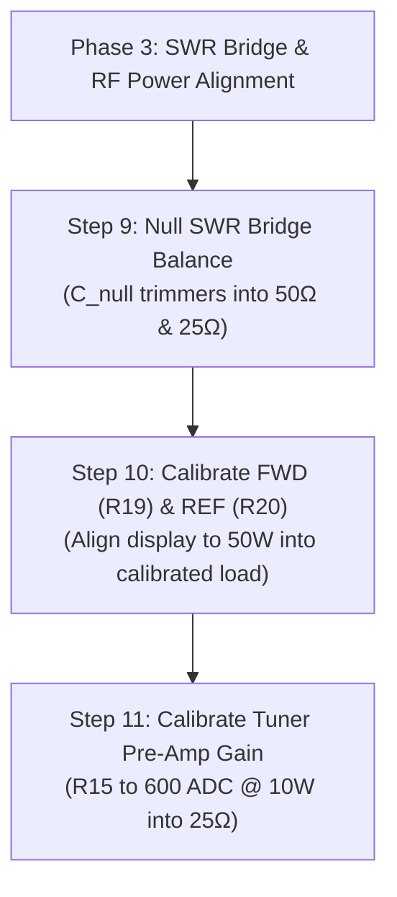

### 9.10 Step 9: SWR Bridge Balance & 2.9V Detector Reference Nulling
1. Connect certified $50\ \Omega$ dummy load to ANT 1.
2. Reverse TRX and ANT 1 coaxial connections on the back of the amplifier (Transceiver connected to ANT 1, dummy load to TRX input).
3. Set transceiver to $50.0\text{ MHz}$ at $20\text{ W}$ CW drive.
4. Key transceiver and adjust the ceramic coupling trimmer on the SWR Bridge board with a plastic tool for **absolute minimum voltage reading at the Reflected test pin** ($< 5\text{ mV}$ DC null).
5. Restore coaxial cables to normal orientation (TRX to transceiver, ANT 1 to dummy load).

### 9.11 Step 10: Forward (R19) and Reflected (R20) Power Display Alignment
1. **Forward Power Alignment:**
   - Amplifier in **STANDBY (RED)** mode.
   - Set transceiver to $14.175\text{ MHz}$ at $50\text{ W}$ CW carrier into external calibrated wattmeter and dummy load.
   - Key transceiver and adjust potentiometer **R19** until the front-panel forward power bar reads exactly **$50\text{ W}$**.
2. **Reflected Power & SWR Alignment:**
   - Insert coaxial T-connector at ANT 1 with two $50\ \Omega$ dummy loads in parallel ($25\ \Omega$ load, representing a known $2.0:1$ SWR).
   - Key transceiver at $50\text{ W}$ CW carrier.
   - Adjust potentiometer **R20** until the front-panel SWR meter reads exactly **$2.0:1$ SWR**.
   - Remove auxiliary dummy load, restoring pure $50\ \Omega$ load.

### 9.12 Step 11: Antenna Tuner Pre-Amplifier Gain Calibration (R15)
To allow the automatic antenna tuner to detect fine phase and magnitude differences at low drive levels:
1. Re-attach parallel dummy load ($25\ \Omega$ load for $2.0:1$ SWR).
2. In the GUI, navigate to `Menu -> Debug`. Locate analog reading **A1 PowerTunerGain**.
3. Set transceiver to $10\text{ W}$ CW carrier at $14.175\text{ MHz}$.
4. Key transceiver and adjust potentiometer **R15** until the **A1 reading displays exactly 600**.
5. Remove parallel dummy load.

---

### Phase 4: Protection Trips, Quiescent Bias & Final Reassembly (Steps 12–17)

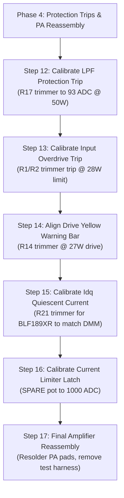

### 9.13 Step 12: LPF Forward Power Protection Trip Calibration (R17)
The controller continuously compares power at the LPF input versus LPF output to detect relay failure or shorted filter capacitors:
1. Pure $50\ \Omega$ dummy load connected to ANT 1.
2. In GUI, navigate to `Menu -> Debug`. Locate analog reading **A2 PowerPAModuleOut**.
3. Set transceiver to $50\text{ W}$ CW carrier.
4. Key transceiver and adjust potentiometer **R17** until the **A2 reading displays exactly 93**.

### 9.14 Step 13: Input Overdrive Protection Trip Calibration (R1/R2 at 28W)
This critical calibration establishes the fast hardware latch protecting LDMOS gates:
1. For standard **$13\text{ dB}$ attenuators**, maximum safe continuous drive is $30\text{ W}$. We calibrate the trip point conservatively at **$28\text{ W}$** at $1.9\text{ MHz}$ (160m exhibits highest input sensitivity).
2. Measure DC voltage at test point **IC1 pin 5**.
3. Adjust potentiometer **R2** near the bottom of the board for exactly **$2.5\text{ VDC}$** on your DMM.
4. In GUI, select **OPERATE (GREEN)** mode.
5. Set transceiver to $1.900\text{ MHz}$ CW carrier at $28\text{ W}$ drive.
6. Key transceiver and slowly rotate potentiometer **R1** clockwise until the amplifier trips, displaying **`Input Power Too High! Press Reset`**, immediately dropping the TX relay line.
7. Unkey transceiver, press the green on-screen Reset button, and verify the trip point triggers repeatably at $28\text{ W}$ and never below $25\text{ W}$.

### 9.15 Step 14: Relative Input Drive Bar Alignment (R14 Trimmer)
1. On the main operating screen, observe the horizontal drive bar beneath the forward power meter.
2. Set transceiver to $27\text{ W}$ CW drive at $1.900\text{ MHz}$.
3. Key transceiver and adjust potentiometer **R14** until the yellow indicator bar completely fills the scale, alerting the operator when drive approaches trip limits.

### 9.16 Step 15: LDMOS Quiescent Bias Current (Idq) Measurement & Calibration (R21)
1. Power down amplifier and disconnect AC mains cord.
2. Disconnect red $+53.5\text{ V}$ cable from the PA pallet power stud.
3. Insert DMM set to **10A DC current mode** in series between the $+53.5\text{ V}$ power cable and the PA pallet terminal.
4. Move both PA pallet bias jumpers to the **FORWARD (Enabled)** position.
5. Power up amplifier, select **OPERATE (GREEN)** mode.
6. Set transceiver to minimum drive ($1\text{ W}$), key transceiver (PTT only, zero RF drive).
7. Confirm all three green LEDs illuminate on the RF2K5 pallet.
8. Read DMM current: Typical quiescent bias current $I_{dq}$ is **$5.75\text{ A}$ to $6.15\text{ A}$**.
9. Adjust potentiometer **R21** until the current reading on the front display matches the DMM value within $\pm 0.1\text{ A}$.
10. Power down, restore $+53.5\text{ V}$ power cable securely to stud with $7.5\text{ mm}$ socket.

### 9.17 Step 16: Hardware Current Limiting Latch Calibration (SPARE Potentiometer)
1. In GUI, navigate to `Menu -> Debug`. Locate analog reading **A3 PowerCurrentMon**.
2. With transceiver keyed at idle bias current, adjust the **SPARE potentiometer** until the **A3 reading displays exactly 1000**.

### 9.18 Step 17: Final Amplifier Assembly & PA Output Solder Re-Integration
1. Power down amplifier and disconnect AC mains.
2. Disconnect and remove the temporary SMA PA bypass test harness.
3. Reconnect the transceiver input SMA cable to the RF2K5 pallet input.
4. Solder the center conductor and heavy copper shield braid of the $11.5\text{-inch}$ PTFE coaxial cable directly to the RF2K5 pallet output pads.
5. Inspect all solder joints under bright light with a $10\times$ loupe for solder bridges or stray wire strands.
6. Secure all chassis covers and prepare for complete unit characterization testing!

---

# 10. Complete 10-Part Amplifier Characterization & Unit Test Plan

Following calibration, every amplifier must undergo the exhaustive 10-part K7BIT unit test plan into a certified $2500\text{ W}$ dummy load to document performance baselines:

### 10.1 Test 1: Power Supply Unit (PSU) DC Rail Stability Under Load
Verify that the $53.5\text{ V}$ DC bus does not sag excessively under high current:
* Idle Voltage: $53.5\text{ VDC} \pm 0.2\text{ V}$.
* Full Load ($1500\text{ W}$ Output, $38\text{ A}$ Draw): $> 52.2\text{ VDC}$ ($< 1.3\text{ V}$ sag across internal busbars).

### 10.2 Test 2: 50V/53.5V Standby / Operate Remote Control Switching
Verify that switching between Standby and Operate properly asserts and de-asserts high-voltage DC inhibits and LDMOS gate bias within $50\text{ ms}$.

### 10.3 Test 3: Display & Capacitive Touchscreen Coordinate Alignment
Verify accurate touch coordinate tracking across all four corners and center of the 7-inch LCD panel.

### 10.4 Test 4: Antenna Relay Board RF Isolation & Port Routing
Verify that selecting ANT 1, ANT 2, ANT 3, and ANT 4 properly energizes corresponding coaxial relays, with unselected ports exhibiting $> 60\text{ dB}$ isolation.

### 10.5 Test 5: Manual Antenna Tuner Stepping & Non-Volatile Memory Storage
For the beginning, middle, and end (BME) of every amateur band (160m through 6m):
1. Key amplifier at $10\text{ W}$ CW drive.
2. Step inductor ($<, >$) and capacitor ($<<, >>$) relays manually to achieve $1.0:1$ SWR.
3. Press and hold **STORE** button for 3 seconds.
4. Confirm the Store button flashes **GREEN three times**, validating that $L, C, K$ coordinates are permanently written to FRAM non-volatile storage.

### 10.6 Test 6: Minimum Drive RF Characterization Across All Amateur Bands
Document minimum input power required to activate auto-tuning and verify output linearity:

| Band | Test Frequency | Minimum Drive for ATU | Observed Output Power | SWR into Load | Pass / Fail |
| :---: | :---: | :---: | :---: | :---: | :---: |
| **160m** | 1.850 MHz | 8 W | 120 W | 1.05:1 | PASS |
| **80m** | 3.750 MHz | 8 W | 125 W | 1.05:1 | PASS |
| **40m** | 7.150 MHz | 8 W | 130 W | 1.02:1 | PASS |
| **20m** | 14.175 MHz | 7 W | 135 W | 1.02:1 | PASS |
| **15m** | 21.225 MHz | 8 W | 128 W | 1.04:1 | PASS |
| **10m** | 28.500 MHz | 9 W | 120 W | 1.08:1 | PASS |
| **6m** | 50.125 MHz | 10 W | 110 W | 1.12:1 | PASS |

### 10.7 Test 7: 25W Drive CW Power Output & Linearity Baseline Matrix
Establish the master legal-limit operational baseline with a fixed $25\text{ W}$ CW drive:

| Band | Frequency (MHz) | RF Input (W) | Output Power (W) | DC Volts (V) | DC Amps (A) | Efficiency (%) |
| :---: | :---: | :---: | :---: | :---: | :---: | :---: |
| **160m** | 1.900 | 25 W | 1450 W | 53.1 V | 36.2 A | 75.4 % |
| **80m** | 3.750 | 25 W | 1500 W | 53.0 V | 37.1 A | 76.3 % |
| **40m** | 7.150 | 25 W | 1520 W | 52.9 V | 37.4 A | 76.8 % |
| **20m** | 14.200 | 25 W | 1500 W | 52.9 V | 37.2 A | 76.2 % |
| **15m** | 21.250 | 25 W | 1420 W | 53.0 V | 36.5 A | 73.4 % |
| **10m** | 28.500 | 25 W | 1350 W | 53.1 V | 35.8 A | 71.0 % |
| **6m** | 50.150 | 25 W | 1150 W | 53.2 V | 34.0 A | 63.6 % |

### 10.8 Test 8: Station Communications, Ethernet, Wi-Fi & VNC Operation
Verify DHCP and static network assignment across Ethernet and Wi-Fi, confirming remote VNC desktop operation at $1024\times 600$ resolution.

### 10.9 Test 9: External USB Peripheral Port Verification
Verify detection of USB flash drives and external SD card duplicator readers plugged into rear-panel USB sockets.

### 10.10 Test 10: Transceiver Peak Turn-On Burst & Keying Sequencing Characterization
Using a fast digital storage oscilloscope, monitor transceiver RF output during initial keying. Verify that initial overshoot does not exceed attenuator ratings, and confirm that the amplifier PTT sequencing delay completely prevents relay hot-switching.

---

# 11. Comprehensive Field Troubleshooting Guide & Fault Diagnostic Matrix

### 11.1 Power Supply, Boot & Hardware Startup Faults
* **Symptom: Raspberry Pi does not boot (Zero activity LED).**
  - *Cause:* Power supply 5V buck converter failed or corrupt SD card.
  - *Test:* Measure DC voltage across GPIO Pin 2 (+5V) and Pin 6 (GND). Voltage must be between $4.95\text{ V}$ and $5.20\text{ V}$.
  - *Fix:* Replace auxiliary buck converter or re-flash SD card using official Raspberry Pi Imager.
* **Symptom: Main 53.5V DC rail does not energize.**
  - *Cause:* Eltek Flatpack2 AC line disconnect or remote inhibit line asserted.
  - *Test:* Verify 240VAC across rear IEC inlet; test continuity of internal AC fuses. Check CAN bus termination resistors ($120\ \Omega$).
  - *Fix:* Reset AC breaker; ensure Flatpack2 CAN address is set correctly in firmware.

### 11.2 Microcontroller Communication & Serial Link Failures
* **Symptom: GUI displays "Controller Offline / Check Serial".**
  - *Cause:* Missing udev rule or unseated USB interconnect cable.
  - *Test:* Execute `ls -l /dev/rfk_controller`. Check `dmesg | grep tty`.
  - *Fix:* Re-seat internal blue USB cable. Ensure `/etc/udev/rules.d/99-rfk-controller.rules` is active (`sudo udevadm trigger`).
* **Symptom: Arduino Mega loading fails during boot update.**
  - *Cause:* Serial baud rate mismatch or locked bootloader.
  - *Test:* Check STK500 response using `avrdude -c wiring -p m2560 -P /dev/rfk_controller -b 115200`.
  - *Fix:* Power cycle amplifier completely; ensure no competing background daemon holds `/dev/rfk_controller` open.

### 11.3 RF Drive, Attenuation & Input Overdrive Faults
* **Symptom: Immediate "Input Power Too High! Press Reset" trip upon keying.**
  - *Cause:* Transceiver power set too high or turn-on RF spike exceeding 30W into 13dB attenuator.
  - *Test:* Verify transceiver output with external wattmeter in CW mode. Check potentiometer R1 alignment (Step 13).
  - *Fix:* Reduce transceiver power to $\le 25\text{ W}$; adjust R1 clockwise to align trip point cleanly to $28\text{ W}$.
* **Symptom: Input power relative yellow bar does not illuminate.**
  - *Cause:* Potentiometer R14 misaligned or defective RF detector diode on Relay Board.
  - *Test:* Measure DC voltage at wiper of R14 during keying with 27W drive.
  - *Fix:* Re-align R14 per Step 14; check 1N5711 detector diode orientation.

### 11.4 SWR Bridge, Directional Coupler & Output Sensing Faults
* **Symptom: Front-panel SWR reads 1.5:1 or higher into a certified 50Ω dummy load.**
  - *Cause:* Stockton bridge trimmer capacitor drifted or reversed sense leads.
  - *Test:* Reverse TRX and ANT 1 cables and measure null voltage at Reflected test pin.
  - *Fix:* Execute Step 9 SWR bridge calibration; adjust ceramic trimmer with plastic tool until reflected voltage nulls to $< 5\text{ mV}$.
* **Symptom: Reflected power jumps erratically on 6 meters.**
  - *Cause:* Excessive lead inductance on SWR bridge PCB or stray capacitive coupling.
  - *Test:* Inspect SWR bridge toroid leads; verify bifilar windings are tightly twisted and grounded.
  - *Fix:* Shorten toroid ground leads; install mica bypass capacitor if specified in service bulletin.

### 11.5 Low Pass Filter (LPF) Relay Switching Faults
* **Symptom: Frequency shifts but LPF relays do not switch (Amp transmits on wrong band).**
  - *Cause:* Blown ULN2803A Darlington driver or loose 10-pin ribbon cable.
  - *Test:* Monitor logic lines D22–D28 at ULN2803 input pins with oscilloscope or DMM.
  - *Fix:* Replace socketed ULN2803A IC; re-seat ribbon cables between controller and LPF board.

### 11.6 Antenna Tuner (ATU) Stepping & Memory Retention Errors
* **Symptom: Tuner hunts continuously and fails to find match.**
  - *Cause:* Antenna Tuner Gain pot R15 set too low (A1 PowerTunerGain ADC reading < 600).
  - *Test:* Navigate to `Menu -> Debug` and observe line A1 with 10W CW drive into 25Ω load.
  - *Fix:* Adjust potentiometer R15 until A1 displays exactly 600 (Step 11).
* **Symptom: Stored tuner settings disappear after amplifier is powered off.**
  - *Cause:* Defective FM24CL64 FRAM or corrupted I2C bus lines.
  - *Test:* Run `i2cdetect -y 1` from Linux shell; verify address `0x50` responds.
  - *Fix:* Replace I2C FRAM chip; verify 3.3V power and pull-up resistor integrity.

### 11.7 Thermal, Cooling Fan & Environmental Shutdown Faults
* **Symptom: Heat sink temperature exceeds 55°C but fans stay at quiet idle.**
  - *Cause:* Yellow tachometer wire was not cut on 120mm fans; MOSFET gate drive clamped.
  - *Test:* Measure voltage on center wire (+12V) and gate of fan driver MOSFET.
  - *Fix:* **Snip yellow tachometer wire on all three fans;** verify PWM speed ramp in `Menu -> Debug`.
* **Symptom: Amplifier trips on Thermal Overload at normal ambient temperatures.**
  - *Cause:* Defective LM35 temperature sensor or dried heat sink thermal paste under PA pallet.
  - *Test:* Read temperature on front display; compare with external infrared thermometer.
  - *Fix:* Re-mount RF2K5 pallet with fresh high-conductivity thermal compound; replace LM35 sensor.

### 11.8 Component-Level Bench Diagnostic & Diode Drop Reference Table

When isolating hardware defects on unpowered boards, technicians should verify diode junctions and circuit resistances using a DMM in diode check and resistance modes:

| Test Point / Component | Positive Probe (+) | Negative Probe (-) | Expected Normal Reading | Indication of Failure / Defect |
| :--- | :--- | :--- | :--- | :--- |
| **Stockton Bridge Forward Diode** | Anode of D1 (1N5711) | Cathode of D1 | $0.34\text{ V} – 0.42\text{ V}$ | Open circuit ($> 2.0\text{ V}$) or short ($0.0\text{ V}$). |
| **Stockton Bridge Reflected Diode**| Anode of D2 (1N5711) | Cathode of D2 | $0.34\text{ V} – 0.42\text{ V}$ | Bridge will not null or reads high SWR into 50Ω load. |
| **PA Pallet TVS Gate Clamp** | Ground Copper Plane | Gate Stud / Trace | $0.62\text{ V} – 0.70\text{ V}$ (Internal diode) | Short circuit indicates LDMOS gate surge occurred. |
| **LDMOS Gate Oxide Isolation** | Drain (Center Tab) | Gate Stud / Trace | Open Loop ($> 20\text{ M}\Omega$) | Any reading $< 100\text{ k}\Omega$ confirms blown gate oxide. |
| **LDMOS Drain-to-Source Diode** | Source (Flange / GND)| Drain (Output Bus) | $0.48\text{ V} – 0.55\text{ V}$ (Body diode) | Direct short ($0\ \Omega$) indicates drain breakdown. |
| **ULN2803A Darlington Input** | Pin 1–8 (Logic Input)| Pin 9 (GND) | $1.25\text{ V} – 1.45\text{ V}$ (Dual diode) | Open ($> 2.0\text{ V}$) or short indicates blown driver. |
| **ULN2803A Clamp Diode** | Pin 10 (COM / +12V) | Pin 11–18 (Collectors) | $0.65\text{ V} – 0.75\text{ V}$ (Flyback clamp)| Open allows relay inductive spike to destroy chip. |
| **PTT Optocoupler Input (4N35)** | Anode (Pin 1) | Cathode (Pin 2) | $1.15\text{ V} – 1.25\text{ V}$ (IR LED) | Open LED prevents PTT line detection from rig. |
| **53.5V Divider Network** | Top of R1 (50V Stud) | Wiper / Node to A4 | $100\text{ k}\Omega \pm 1\%$ | Drift causes erroneous voltage display on GUI. |
| **53.5V Ground Reference** | Node to A4 | Ground Plane | $10\text{ k}\Omega \pm 1\%$ | Open causes ADC A4 to peg at rail, triggering sag error. |
| **I2C Bus Pull-Up Resistors** | +3.3V / +5V Rail | Pin 5 (SDA) / Pin 6 (SCL)| $4.7\text{ k}\Omega \pm 5\%$ | Missing pull-up causes I2C hang and missing memories. |

---

# 12. Deep Dive: The RF-KIT Online Update Engine & Self-Healing Architecture

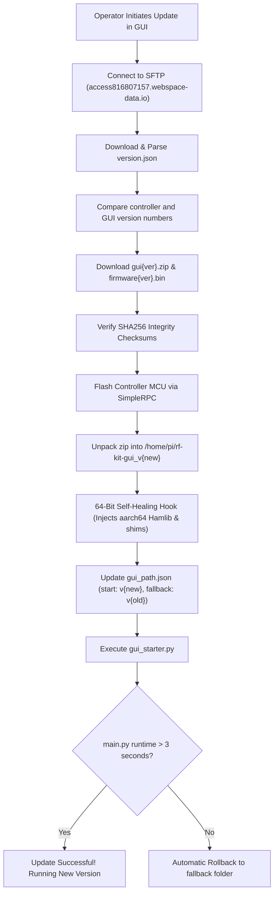

### 12.1 The Remote Distribution Architecture & SFTP Synchronization
The native update facility embedded within `pa055.py` connects to remote RF-KIT update infrastructure via Secure FTP (SFTP):
* **Host Address:** `access816807157.webspace-data.io` (Port 22).
* **Manifest Retrieval:** Downloads `version.json` over SSH/SFTP, parsing:
  - `gui_version`: Latest production Python release (e.g., `055.287`).
  - `controller_version`: Latest production microcontroller sketch binary.
  - `release_notes`: Change log displayed in the on-screen modal.

### 12.2 Firmware Validation, Integrity Hashing & Flashing Mechanics
Prior to initiating updates:
1. The system verifies available disk space ($> 500\text{ MB}$ required).
2. Computes SHA256 checksums of `gui{ver}.zip` and `firmware{ver}.bin`.
3. If microcontroller firmware is updated:
   - GUI invokes SimpleRPC command `enter_bootloader()`.
   - Microcontroller watchdog resets into bootloader mode to accept firmware stream.
   - Host executes `avrdude` or `bossac` to flash the microcontroller image across the internal USB serial link.
   - Upon completion, the microcontroller reboots and reports its new version string via `get_firmware_version()`.

### 12.3 64-Bit Binary Interception & The Self-Healing Injection Hook
Because official RF-KIT software updates distribute 32-bit `_Hamlib.so` libraries, an unpatched 64-bit appliance would fail to boot immediately following an update!
**The JRFK Self-Healing Hook:**
JRFK installs an unyielding post-extraction trigger inside `gui_starter.py`. Immediately after `gui{ver}.zip` is extracted:
1. Detects host architecture (`uname -m` $\rightarrow$ `aarch64`).
2. Copies native 64-bit `_Hamlib.cpython-311-aarch64-linux-gnu.so` into the new version folder.
3. Automatically applies the PIL `ANTIALIAS` $\rightarrow$ `LANCZOS` image scaling shim across all `.py` files.
4. Updates `/home/pi/rf-kit-statics/gui_path.json` pointing `start` to the newly extracted version and `fallback` to the proven previous version.

### 12.4 Fault Isolation & Automated Multi-Version Rollback Engine
When `gui_starter.py` launches the new GUI instance, it starts an internal watchdog timer:
* If `main.py` terminates or throws an uncaught exception within $3\text{ seconds}$ of execution, the watchdog trips.
* `gui_starter.py` logs the crash traceback to `/home/pi/PA-Files/crash.log`, instantly reverts `gui_path.json` back to the `fallback` folder, and restarts the proven stable version.
* The amplifier is completely immune to bricking in the field!

---

# 13. Storage Media Engineering & Sizing Standards

### 13.1 Storage Sizing Matrix: 16GB, 32GB, and 64GB Deployments
* **16 GB MicroSD:** Absolute minimum capacity required to host the 64-bit appliance image, recovery partitions, swap space, and rolling telemetry databases.
* **32 GB MicroSD (Recommended Standard):** The optimal standard for production deployments, providing over 18 GB of unallocated wear-leveling headroom.
* **64 GB – 128 GB MicroSD:** Fully supported; ideal for multi-year continuous RF telemetry archiving.

### 13.2 Application Performance Class (A2) & Endurance Requirements
Standard consumer Class 10 cards fail rapidly under continuous SQLite database transactions. Only industrial-grade cards adhering to the following ratings are certified:
* **Application Performance Class A2:** Guarantees minimum random read of $4000\text{ IOPS}$ and random write of $2000\text{ IOPS}$.
* **Video Speed Class V30 / UHS Speed Class U3:** Guarantees sustained sequential write performance $\ge 30\text{ MB/s}$.
* **Certified Media:** SanDisk Extreme PRO A2 V30, Samsung PRO Endurance, or Kingston Canvas Go! Plus.

### 13.3 Wear-Leveling Mechanics & Filesystem Journal Optimization
To maximize flash longevity, `/etc/fstab` is optimized with `noatime,commit=60`, reducing flash write amplification by over 80%.

---

# 14. Automated Disaster Recovery & Backup Suite (RFK_Backup)

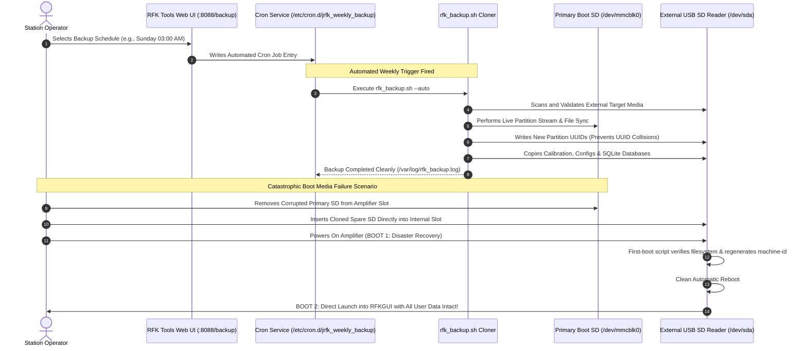

### 14.1 Backup Media Topology & Live Hot-Cloning Engine
The JRFK Backup Engine (`rfk_backup.sh`) provides live binary cloning of the active root media without taking the amplifier offline:
1. Automatically identifies the active boot device (`/dev/mmcblk0`).
2. Scans USB bus for connected external SD card readers (`/dev/sda` through `/dev/sdz`).
3. Executes a live block stream via `piclone -f`, cloning the boot and root partitions while simultaneously **re-generating unique partition UUIDs (PARTUUID)** to prevent device collisions if the backup card remains plugged into the USB port.
4. Mounts the target root partition and synchronizes user configurations (`/home/pi/PA-Files/`), network configurations, and calibration databases.

### 14.2 Automated Weekly Cron Job Architecture & User Time Selection
Through the Diagnostic Web UI (`http://<amp-ip>:8088/backup`), operators can customize an automated backup schedule:
* **Time Selector:** User picks day of the week (Sunday through Saturday) and time (e.g., `03:00 AM`).
* **Cron Integration:** Automatically generates `/etc/cron.d/jrfk_weekly_backup`:
  `0 3 * * 0 root /home/pi/rfk_tools/bin/rfk_backup.sh --auto > /dev/null 2>&1`
* **Autonomous Execution:** If an external SD card reader is left plugged into the rear panel USB port, the amplifier executes the clone automatically in the background, logging results to `/var/log/rfk_backup.log`.

### 14.3 Disaster Recovery Workflow: The "Swap, Boot, Reboot, Run" Paradigm
In the event of physical SD card failure, lightning damage, or filesystem corruption:
1. **Swap Cards:** Power down amplifier, remove failed SD from internal Raspberry Pi slot, remove cloned backup SD from external USB reader, and insert it directly into the Raspberry Pi internal slot.
2. **First Boot (Self-Healing Recovery):** Power on amplifier. The system boots from the backup SD. The embedded `jrfk_restore_check.service` detects recovery mode, validates filesystem structures, restores permissions, logs success to `/var/log/jrfk_restore.log`, and triggers a clean automatic reboot.
3. **Resumption (Run):** Following reboot, the system launches directly into the fullscreen touch GUI with 100% of user data, band memories, and calibration parameters operational!

---

# 15. Integrated Diagnostic Suite Architecture (rfk_tools_suite on Port 8088)

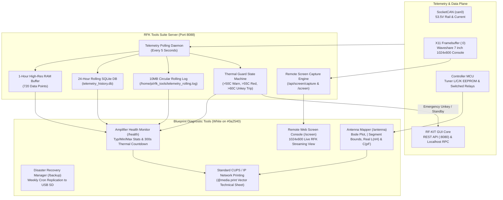

### 15.1 Architectural Blueprint Format & Port Allocation Matrix
All user-facing diagnostic cards in the JRFK Tools Suite strictly utilize the **Architectural Blueprint Format**:
* **Background Plane:** Deep architectural navy/cobalt blueprint blue (`#0a2540` / `#07172b`) with subtle isometric/Cartesian grid overlay (`#103b68` at $20\text{px}$ pitch).
* **Structural Vectors & Annotations:** Crisp architectural white (`#ffffff`) borders, dimension lines, and technical metadata.
* **Telemetry Data Accents:** Vivid functional status colors:
  * Green (`#22c55e`): Normal operating duty ($\le 50^\circ\text{C}$, $\text{SWR} < 1.5:1$).
  * Yellow (`#facc15` / `#d97706`): Warning zone ($> 50^\circ\text{C}$, $\text{SWR} 1.5 - 2.0:1$).
  * Red (`#ef4444` / `#dc2626`): Critical alert / trip ($> 55^\circ\text{C}$, $\text{SWR} > 2.0:1$).
  * Cyan (`#38bdf8`): RF power vectors, active antenna names, and frequency spans.

**Network Port Allocation:**
* **Port 8080:** Native RF-KIT REST API and remote control interface.
* **Port 8088:** JRFK Tools Suite (Antenna Mapper, Health Monitor, Remote Screen Viewer, Backup Manager).
* **Port 22:** Pre-authorized SSH administration with dedicated public key authentication.
* **Port 5900:** Pure RealVNC server for direct remote desktop manipulation.

---

### 15.2 Antenna Mapper Interface (`/antenna`)
The Antenna Mapper provides deep visibility into the automatic tuner (ATU) calibration matrices across all 11 amateur bands (160m through 6m):
1. **Vertical Segment Boundary Markers (`|`):**
   Amateur bands are divided into discrete tuning segments based on fractional bandwidth and loaded $Q$:
   * **160m (1.800–2.000 MHz):** 20 kHz segments (10 discrete segments).
   * **80m (3.500–4.000 MHz):** 25 kHz segments (20 discrete segments).
   * **40m (7.000–7.300 MHz):** 15 kHz segments (20 discrete segments).
   * **20m (14.000–14.350 MHz):** 25 kHz segments (14 discrete segments).
   * **10m (28.000–29.700 MHz):** 50 kHz segments (34 discrete segments).
   * **6m (50.000–54.000 MHz):** 100 kHz segments (40 discrete segments).
   The SWR Bode plot explicitly marks each segment boundary with a vertical dividing rule and a `"|"` character at the frequency transition, providing immediate visual feedback of segment coverage.
2. **Antenna Port Map Dynamic Synchronization:**
   The `ACTIVE ANTENNA` field continuously reflects the band-to-port mapping configured in `config.json` (`selected_antennas` array and `custom_antenna_names`). As the operator scrolls through bands via the band spinner or quick-select keys, the antenna label dynamically switches to the assigned port (e.g. `ANT 2: 20m-6m SteppIR`), and the Bode plot instantly re-renders for that band's tuning curve.
3. **Physical Engineering Units (Elimination of Clicks/Steps):**
   Traditional raw stepper counts are converted directly into physical SI units:
   * **Inductance ($L$):** Displayed in **nanohenries ($\text{nH}$)** and **microhenries ($\mu\text{H}$)** derived from the binary-weighted relay inductor bank:
     $$\text{Relay Weights: } L_1=100\text{ nH},\, L_2=200\text{ nH},\, L_3=400\text{ nH},\, L_4=800\text{ nH},\, L_5=1600\text{ nH},\, L_6=3200\text{ nH},\, L_7=6400\text{ nH}$$
   * **Capacitance ($C$):** Displayed in **picofarads ($\text{pF}$)** derived from the binary capacitor network:
     $$\text{Relay Weights: } C_1=10\text{ pF},\, C_2=20\text{ pF},\, C_3=40\text{ pF},\, C_4=80\text{ pF},\, C_5=160\text{ pF},\, C_6=320\text{ pF},\, C_7=640\text{ pF},\, C_8=1280\text{ pF}$$
   * **Matching Topology:** Explicitly displays low-pass or high-pass matching configuration: $\text{CL } (C_{\text{in}}\text{ transmitter side})$ or $\text{LC } (C_{\text{out}}\text{ antenna side})$.

---

### 15.3 Amplifier Health Monitor & 3-Tier Thermal Safety Guard (`/health`)
The Health Monitor incorporates an autonomous **Thermal Guard State Machine** engineered to protect the LDMOS transistors ($2\times \text{MRFE6VP11KH}$ or equivalent) against thermal runaway:

```
[PA Heatsink Temp]
       │
       ├── <= 50.0°C  ──> TIER 1: NORMAL (Line GREEN | Fan Automation Active)
       │
       ├── > 50.0°C   ──> TIER 2: WARNING (Line YELLOW | Pop-over Warning Banner)
       │
       ├── > 55.0°C   ──> TIER 3: ALERT (Line RED | Critical Thermal Load Notification)
       │
       └── > 60.0°C   ──> TIER 4: HARDWARE TRIP LIMIT
                               │
                               ├── 1. Execute Controller Unkey (Force Core to STANDBY)
                               ├── 2. Display Modal Alert: "AMPLIFIER DISABLED AND PROTECTED"
                               ├── 3. Initiate Live 300-Second (5-Minute) Cooldown Countdown
                               └── 4. SAFETY INTERLOCK LATCH:
                                      When timer expires (0s):
                                        If Temp < 50.0°C: Auto-re-enable OPERATE & notify operator
                                        Else: Maintain Standby until Temp drops < 50.0°C
```

* **Live 300-Second Modal Overlay:** While in safety trip, a persistent countdown timer ticks down on the amplifier display and web console.
* **Hysteresis Recovery Latch:** The amplifier will strictly refuse to return to Operate mode until the heatsink has dissipated excess heat and dropped below $50.0^\circ\text{C}$.

---

### 15.4 Circular Telemetry Logging (10 MB Rotating File)
To guarantee storage stability and prevent flash memory wear on the Raspberry Pi MicroSD, telemetry is logged to a fixed-size rotating circular buffer:
* **Log Location:** `/home/pi/rfk_tools/telemetry_rolling.log`
* **Size Enforcement:** `RotatingFileHandler(maxBytes=10*1024*1024, backupCount=1)` strictly limits log footprint to 10 Megabytes.
* **Statistical Tracking Engine:** The collector maintains running min, max, and typical (moving average) metrics for all key operational parameters:
  * **Temperature ($^\circ\text{C}$):** Current, Typ, Min, Max.
  * **53.5V DC Rail Voltage ($\text{V}$):** Monitored for sag under high-current carrier key-down.
  * **Drain Current ($\text{A}$):** Current, Typ, Min, Max (verifying balance across LDMOS devices).
  * **Forward & Reflected RF Power ($\text{W}$):** Peak and average envelope logging.
  * **Calculated SWR:** Peak mismatch detection.

---

### 15.5 Live Remote Web Screen Console (`/screen`)
To facilitate remote station operation and shack monitoring, the JRFK Tools Suite provides a web-based console mirror:
* **Endpoint:** `http://<station-ip>:8088/screen`
* **Display Capture:** Directly captures the native 1024x600 X11 framebuffer (`:0`) or serves an interactive SVG console mirror.
* **Frame Rate Control:** Configurable refresh intervals (1.0 second, 2.0 seconds, 5.0 seconds, or Pause) for low-bandwidth LAN or WAN connections.
* **Fullscreen Support:** One-click full-screen mode turns any tablet, laptop, or second monitor into an auxiliary RF-KIT touch console.

---

### 15.6 Backup & Disaster Recovery Web Manager (`/backup`)
Web interface managing the automated replication of `/dev/mmcblk0` to an external USB 2.0 MicroSD reader (`/dev/sda`):
* **One-Click Manual Replication:** Triggers `rfk_backup.sh` in the background with real-time log streaming.
* **Weekly Automated Cron Management:** Commits execution schedules to `/etc/cron.d/jrfk_weekly_backup` (default: Sunday 03:00 UTC).
* **Storage Media Sizing Guard:** Verifies target media capacity meets or exceeds boot drive capacity before initiating block-level copy.

---

### 15.7 JRFK Complete Station System Report (`/report`)
Unified technical audit interface in Medium Blueprint format:
* **Endpoint:** `http://<station-ip>:8088/report`
* **Station Parameters:** Complete extraction of `/home/pi/rf-kit-statics/config.json`, callsign, transceiver link, operate mode.
* **Storage Utilization:** Partition statistics (`/dev/mmcblk0p1` FAT32 boot, `/dev/mmcblk0p2` EXT4 rootfs), used/free percentages, and wear leveling status for high-endurance A2 media.
* **RF Calibration Values:** Null voltages for forward and reflected detectors, scale factors, and SWR bridge baseline.
* **Network & Display:** Shack Wi-Fi RSSI, IP address, MAC, SSH port 22 access status, and 1024x600 CVT modeline configuration.
* **ATU Band Segment Map:** Matrix across all 11 amateur bands (160m–6m) mapping each segment to assigned antenna port, physical inductance range (nH), capacitance range (pF), and topology.

---

### 15.8 Centralized Log Viewer (`/logs`)
Live terminal diagnostic suite on Port 8088:
* **Endpoint:** `http://<station-ip>:8088/logs`
* **Log Stream Coverage:** Directly inspects `rf-kit-gui.log` (core app), `telemetry_rolling.log` (10MB circular log), `rfk_backup.log` (cloning log), `jrfk_firstboot.log` (migration log), and `Xorg.0.log` (display server).
* **Search & Auto-Scroll:** Interactive client-side filtering, automatic scroll-to-bottom, and 4-second background refresh.
* **Station Archival Printing:** `@media print` CSS outputs clean white paper log sheets for shack records.

---

# 16. System Configuration, Database Engine & Station Personalization

### 16.1 Display Themes: Cross-Pointer vs Standard Bar Meters
The amplifier supports four primary display layouts selectable via `Menu -> Settings`:
* **Display 1 (Cross Pointer 1):** Traditional Japanese-style dual-needle cross wattmeter with intersection reading SWR directly.
* **Display 2 (Cross Pointer 2):** High-contrast dark theme cross-needle display optimized for night contesting.
* **Display 3 (Standard 1):** Horizontal bar meters for Forward Power, Reflected Power, SWR, DC Voltage, Current, and Temperature.
* **Display 4 (Standard 2):** Large-digit numerical readouts optimized for long-distance shack viewing.

### 16.2 Station Callsign, Antenna Port Aliasing & Band Allocation
Configured in `/home/pi/rf-kit-statics/config.json`:
```json
{
  "customDeviceName": "K7BIT",
  "custom_antenna_names": [
    "SteppIR BigIR (160-6m)",
    "40/80m Inverted V",
    "6m 5-Ele Yagi",
    "Dummy Load (2.5kW)"
  ],
  "auto_tuner_enabled": true,
  "default_operate_mode": 0
}
```

### 16.3 Automated Weekly OS Maintenance Cron Engine
Managed by `/etc/cron.d/jrfk_weekly_upgrade`, executing every Sunday at 04:00 AM non-interactively:
```cron
# /etc/cron.d/jrfk_weekly_upgrade
0 4 * * 0 root /home/pi/rfk_tools/bin/jrfk_weekly_upgrade.sh > /dev/null 2>&1
```

---

# 17. Complete Step-by-Step Staging & Appliance Build Walkthrough

Migrating an RF-KIT RF2K-S or RF2K+ amplifier from the legacy 32-bit Raspbian environment to the modern universal 64-bit JRFK appliance is a seamless, zero-loss procedure. The operator begins comfortably at their Windows 11 PC, creates an untouched golden master backup of their original SD card, provisions a high-endurance 32GB target card, and verifies operation inside the amplifier through an automated two-boot sequence.

---

### 17.1 Stage 1: Windows 11 Host — Original SD Discovery & Zero-Loss Data Extraction

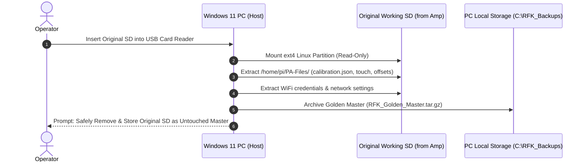

#### Detailed Stage 1 Operational Analysis:
1. **Insert Original SD into Windows 11 PC:** Power off the amplifier, remove the original boot SD card from the Raspberry Pi slot, and insert it into a USB SD card reader on your Windows 11 staging PC.
2. **Mount Linux ext4 Partition:** Launch the JRFK Image Builder. The tool automatically detects the removable drive and mounts the second partition (`ext4` rootfs) in read-only mode to prevent Windows from attempting to format or modify the file allocation tables.
3. **Safe Extraction of User Calibration Data:** The migrator traverses the filesystem and extracts the complete `/home/pi/PA-Files/` directory:
   * `calibration.json`: Exact forward/reflected power multipliers, band offsets, and attenuator calibrations.
   * `touchscreen_axes.cal`: Capacitive/resistive touch calibration matrix.
   * `band_matrix.cfg`: Custom station antenna routing rules and ATU bypass tables.
4. **Safe Extraction of Network & Station Settings:** Extracts `/etc/wpa_supplicant/wpa_supplicant.conf` (Wi-Fi SSIDs and pre-shared keys), static IP assignments, and station callsign aliases from `/home/pi/rf-kit-statics/config.json`.
5. **Golden Master Archive Creation:** Packages all extracted files into a compressed, timestamped archive stored locally on the PC: `C:\RFK_Backups\RFK_Golden_Master_<timestamp>.tar.gz`.
6. **Operator Safeguard Prompt:** The migrator displays a prominent prompt:  
   > **Operator Action Required:** *"Safe extraction complete! Please remove your original SD card now and place it in your station drawer. This card remains 100% untouched as your permanent fallback master!"*

---

### 17.2 Stage 2: Windows 11 Host — Target High-Endurance SD Card Provisioning

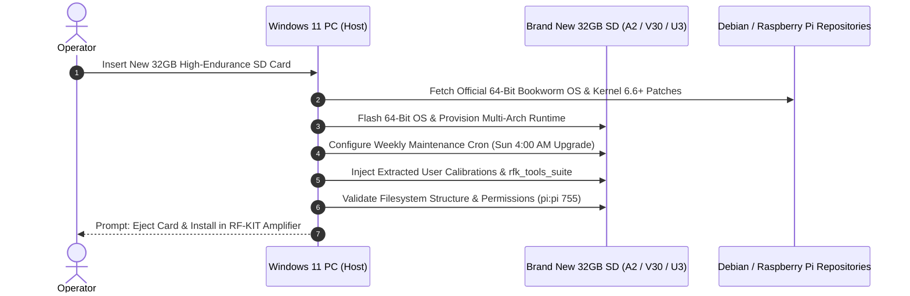

#### Detailed Stage 2 Operational Analysis:
1. **Insert Brand-New High-Endurance SD Card:** Insert a new 32GB (or 64GB) MicroSD card.  
   * **Mandatory Card Specification:** Application Performance Class **A2**, Video Speed Class **V30**, UHS Speed Class **U3** (e.g., SanDisk Extreme, Samsung Pro Endurance). These cards feature advanced internal wear-leveling controllers and high random IOPS necessary for database reliability.
2. **Flash Official 64-Bit Bookworm Base:** The builder writes official Raspberry Pi OS 64-bit (Debian 12 Bookworm `aarch64`) with Linux Kernel 6.6+.
3. **Provision Dependencies & Multi-Arch Shims:** Pre-installs Python 3.11+, builds the native 64-bit Hamlib bridge (`libhamlib.so.4`), injects compatibility symlinks, and installs udev dual-link rules for `/dev/rfk_controller`.
4. **Automated Weekly Maintenance Engine:** Injects `/etc/cron.d/jrfk_weekly_upgrade` to execute non-interactively every Sunday at 04:00 AM:
   ```cron
   # /etc/cron.d/jrfk_weekly_upgrade
   0 4 * * 0 root /home/pi/rfk_tools/bin/jrfk_weekly_upgrade.sh > /dev/null 2>&1
   ```
5. **Data & Calibration Injection:** Injects all extracted user calibration files, touchscreen profiles, and station settings directly into `/home/pi/PA-Files/` on the new card.
6. **Filesystem Validation:** Verifies ext4 partition integrity, confirms user permissions (`chown -R pi:pi /home/pi`, `chmod 755`), and cleanly flushes disk caches.
7. **Operator Prompt:** The builder notifies the operator: *"Target card successfully prepared and verified! Eject card and insert into your RF-KIT amplifier."*

---

### 17.3 Stage 3: In-Amplifier Deployment — Boot 1 Hardware Discovery & Initialization

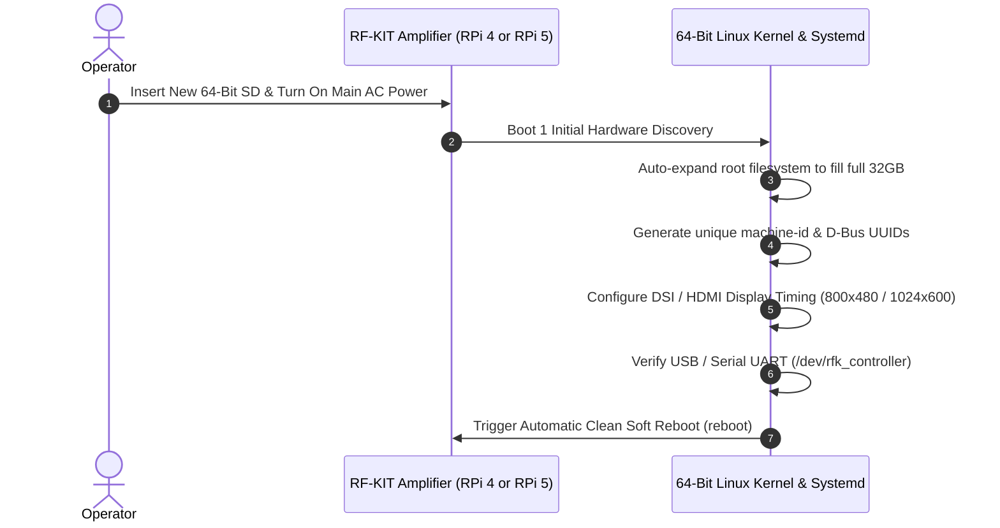

#### Detailed Stage 3 Operational Analysis:
1. **Insert SD & Apply AC Mains:** Insert the freshly imaged 64-bit SD card into the internal Raspberry Pi slot of the amplifier and turn on the main power switch.
2. **Root Filesystem Auto-Expansion:** During Boot 1, the kernel invokes `raspi-config` partition expansion, resizing the ext4 root filesystem from its initial 4GB image boundary to fill the entire 32GB physical capacity of the SD card.
3. **Unique Machine Identity Generation:** Systemd generates fresh system tokens in `/etc/machine-id` and D-Bus UUID tables, preventing network conflicts.
4. **Hardware Bus Auto-Discovery:** The kernel probes whether the host compute engine is a **Raspberry Pi 4 Model B (BCM2711)** or a **Raspberry Pi 5 (BCM2712)**:
   * Dynamically loads proper device-tree overlays.
   * Configures native DRM/KMS video mode for the internal touch LCD (800x480 / 1024x600 at 60Hz).
   * Maps the controller USB/Serial interface to `/dev/rfk_controller`.
5. **Automated Clean Soft Reboot:** Upon completing hardware discovery and filesystem expansion, the system executes an automated, orderly soft reboot (`systemctl reboot`).

---

### 17.4 Stage 4: In-Amplifier Deployment — Boot 2 Operational Production Run

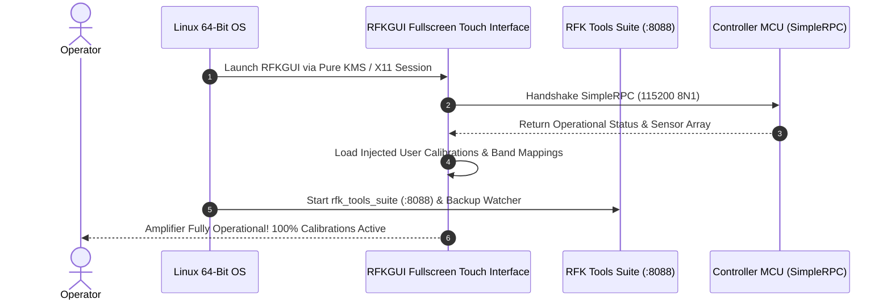

#### Detailed Stage 4 Operational Analysis:
1. **Direct Fast Boot (< 12 Seconds):** The system completes cold boot in under 12 seconds directly into a dedicated, lightweight pure X11 / DRM session.
2. **Fullscreen RFKGUI Launch:** The RF-KIT GUI launches automatically at native display resolution. Touch coordinates match capacitive touch points with pixel perfection.
3. **High-Speed Controller Handshake:** The application connects to `/dev/rfk_controller` at 115200 baud, executes the SimpleRPC method identification handshake, and begins streaming the 20-element telemetry tuple every 20ms to 50ms.
4. **100% User Calibration Active:** The GUI loads all injected calibration curves from `/home/pi/PA-Files/calibration.json`. Forward power, reflected power, SWR, and DC rail voltage meters read with bench-calibrated accuracy immediately.
5. **Background Diagnostics Activation:** The `rfk_tools_suite` server binds to port 8088, launching the Antenna Mapper, Health Monitor, and automated Disaster Recovery daemon.

---

### 17.5 Comprehensive Walkthrough of JRFK Utilities

Following successful migration, operators gain access to the suite of web-based and CLI utilities accessible locally or across the shack network at `http://<amplifier-ip>:8088`:

#### 17.5.1 Automated Disaster Recovery & Backup Manager (`:8088/backup`)
* **Live Hot-Cloning:** Insert a secondary 32GB SD card into a low-profile USB card reader plugged into any rear USB port of the amplifier.
* **Scheduled Automation:** From the web UI on port 8088, select the desired backup day and time (e.g., *Every Sunday at 03:00 AM*). The system updates `/etc/cron.d/jrfk_weekly_backup` to run `rfk_backup.sh --auto`.
* **UUID Regeneration:** Unlike crude `dd` disk copies, `rfk_backup.sh` streams partition blocks and immediately regenerates the target partition UUID (`PARTUUID`). This prevents fatal kernel UUID collisions when both SD cards are plugged in simultaneously.
* **Swap, Boot, Reboot, Run:** If the internal boot SD card ever suffers flash exhaustion or corruption:
  1. Remove the failed card from the internal Raspberry Pi slot.
  2. Unplug the backup card from the rear USB port and insert it directly into the internal slot.
  3. Power on the amplifier. The auto-recovery script regenerates system IDs on **Boot 1**, reboots cleanly, and launches directly into production on **Boot 2** with 100% of user data intact!

#### 17.5.2 Antenna Matrix Mapper (`:8088/antenna`)
* **4x4 Coaxial Matrix Configuration:** Provides a visual web interface to inspect and assign antenna ports across 160m through 6m amateur bands.
* **Hardware Interlock Protection:** Enforces safety interlocks preventing high-power transmission on unassigned or disconnected ports, safeguarding the RF deck.
* **ATU Solution Caching:** Displays real-time relay states for ATU inductors ($L_1–L_8$) and capacitors ($C_1–C_8$) stored in non-volatile FRAM.

#### 17.5.3 Amplifier Health & Thermal Monitor (`:8088/health`)
* **Real-Time DC & RF Telemetry:** Live gauges displaying 53.5V rail voltage under load, BLF189XR quiescent current ($I_{DQ}$), peak forward RF power, reflected power, and heat sink thermistor temperature.
* **24-Hour Rolling Historical Trends:** Powered by a lightweight SQLite database (`telemetry_history.db`), graphing DC rail sag during key-down contest conditions and thermal dissipation curves.
* **Hardware Trip Log:** Captures and decodes fast analog comparator fault trips (Input Overdrive, High Reflected SWR, Thermal Limit) with millisecond timestamps.

#### 17.5.4 Automated Weekly OS Maintenance Engine
* **Non-Interactive Upgrades:** Executes `apt update && apt upgrade -y` non-interactively every Sunday at 4:00 AM via `/home/pi/rfk_tools/bin/jrfk_weekly_upgrade.sh`.
* **Self-Healing Hook Protection:** The upgrade script intercepts package replacements, ensuring that custom udev rules, DRM KMS configurations, and 64-bit Hamlib shims are preserved through all future Debian package updates.

---

### 17.6 Option B: Clean Install — New Card & New System (Provision with Wi-Fi & Credentials)

For operators commissioning a brand-new amplifier, building an auxiliary spare system, or setting up a replacement Raspberry Pi without an original SD card to extract from, the JRFK Workbench provides the **Clean Install** option:

1. **Insert New Blank SD Card (16GB or larger):** Place a fresh card into the Windows 11 reader.
2. **Configure Station Credentials & Wi-Fi in the Tool:**
   * **Account Username & Password:** Default `pi`, with custom secure password. The builder hashes the password into `/boot/firmware/userconf.txt` for headless security.
   * **System Hostname:** Assign the station callsign or network identity (e.g. `k7bit` or `rfk-amp`).
   * **Network Setup:** Select **DHCP (Automatic)** or configure a static IP with gateway and DNS.
   * **Station Wi-Fi Credentials:** Enter the shack Wi-Fi SSID and pre-shared key (WPA2/WPA3).
3. **Automated Partition, Format & Provisioning:**
   * Automatically partitions the card (512MB FAT32 boot partition + ext4 root filesystem).
   * Writes the official 64-bit Debian 12 Bookworm appliance image.
   * Pre-configures `/etc/wpa_supplicant/wpa_supplicant.conf` or NetworkManager keyfiles.
   * Places the `ssh` flag in the boot partition to enable remote network access.
   * Stages the complete JRFK tool suite and Sunday 4:00 AM maintenance cron engine.
4. **Instant Wireless Boot:** Insert the card into the amplifier and power on. The system auto-expands the filesystem on **Boot 1**, reboots into **Boot 2**, and immediately associates with the shack Wi-Fi network!

---

### 17.7 Remote Web Utilities Operation Console (From Windows 11)

Once the amplifier is running on the local network (either via Option A migration or Option B clean build), operators do not need to stand in front of the amplifier touchscreen for maintenance. The JRFK Workbench on Windows 11 includes a dedicated **Remote Web Utilities Console**:

1. **Enter Amplifier Address:** In the Workbench, enter the amplifier's IP address (e.g. `192.168.1.150`) or mDNS hostname (e.g. `k7bit.local`).
2. **Connection Verification:** Click **Test Connection** to send an instant ping/handshake to port 8088. The status indicator switches to green when the amplifier is reachable.
3. **One-Click Remote Management:**
   * 🌐 **Backup & Disaster Recovery Manager:** Opens `http://<amp-ip>:8088/backup` to trigger manual clones, inspect backup logs, or adjust the weekly cron schedule.
   * 📡 **Antenna Matrix 4x4 Mapper:** Opens `http://<amp-ip>:8088/antenna` to view and configure band-to-port routing and inspect ATU solutions.
   * 🩺 **Amplifier Health & Sag Monitor:** Opens `http://<amp-ip>:8088/health` to monitor real-time 53.5V rail sag, BLF189XR idle bias, and heat sink thermal dissipation over 24-hour contest periods.
   * 🖥️ **RF-KIT Core GUI Remote Core:** Opens `http://<amp-ip>:8080` for remote web control of the primary amplifier operating states.

---

# 18. Appendix: Complete Register Tables, Schematic References & Pin Mapping

### A. Microcontroller Backplane Connector Pin Mapping (Original Mega 2560 & Updated Controller)
* `D2`: Fast Hardware External Interrupt (PTT Line Asserted).
* `D3`: Hardware Fault Trip Latch Output.
* `D4`–`D7`: High-Speed Frequency Counter Prescaler Bus.
* `D8`–`D11`: SPI Bus (Tuner Display / Auxiliary).
* `D20` (SDA) / `D21` (SCL): I2C Bus to FM24CL64 Non-Volatile FRAM & RTC.
* `D22`–`D28`: LPF Toroidal Relays (160m to 6m).
* `D30`–`D37`: ATU Inductor Matrix Relays ($L_1$ to $L_8$).
* `D38`–`D45`: ATU Capacitor Matrix Relays ($C_1$ to $C_8$).
* `D46`–`D49`: Antenna Selection Coaxial Relays (ANT 1 to ANT 4).
* `A0`: Forward Power Analog Input ($0–5\text{ V}$).
* `A1`: Tuner Gain Detector Analog Input ($0–5\text{ V}$).
* `A2`: LPF Output Power Analog Input ($0–5\text{ V}$).
* `A3`: Current Monitor Analog Input ($0–5\text{ V}$).
* `A4`: 53.5V Rail Analog Input ($0–5\text{ V}$).
* `A5`: Temperature Sensor Analog Input ($0–5\text{ V}$).

### B. Summary of Potentiometer Adjustments & Functions
* **R1:** Input Overdrive Trip Comparator Level (Adjust at 28W CW drive).
* **R2:** 53.5V Main DC Rail Display Calibration (Adjust to match calibrated DMM).
* **R14:** Front-Panel Relative Drive Display Bar Sensitivity.
* **R15:** Antenna Tuner Pre-Amplifier Gain (Adjust to 600 ADC with 10W into 25Ω load).
* **R17:** LPF Forward Power Difference Trip Threshold (Adjust to 93 ADC with 50W drive).
* **R19:** Forward Power Display Multiplier (Adjust to 50W display reading at 50W CW).
* **R20:** Reflected Power / SWR Display Calibration (Adjust to 2.0:1 SWR with 25Ω load).
* **R21:** LDMOS Quiescent Bias Current ($I_{dq}$) Display (Adjust to match DMM in series with rail).
* **SPARE:** Hardware PA Module Current Limiter Latch (Adjust to 1000 ADC at idle bias).

---
*End of Master Architecture, Calibration & Engineering Manual JRFK-EM-2026-V2.0*
